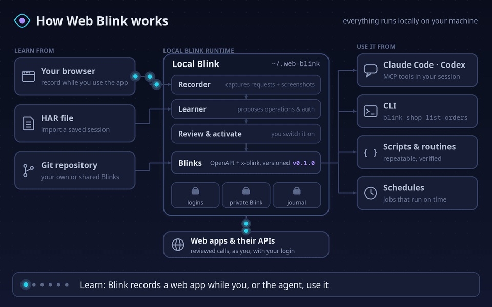
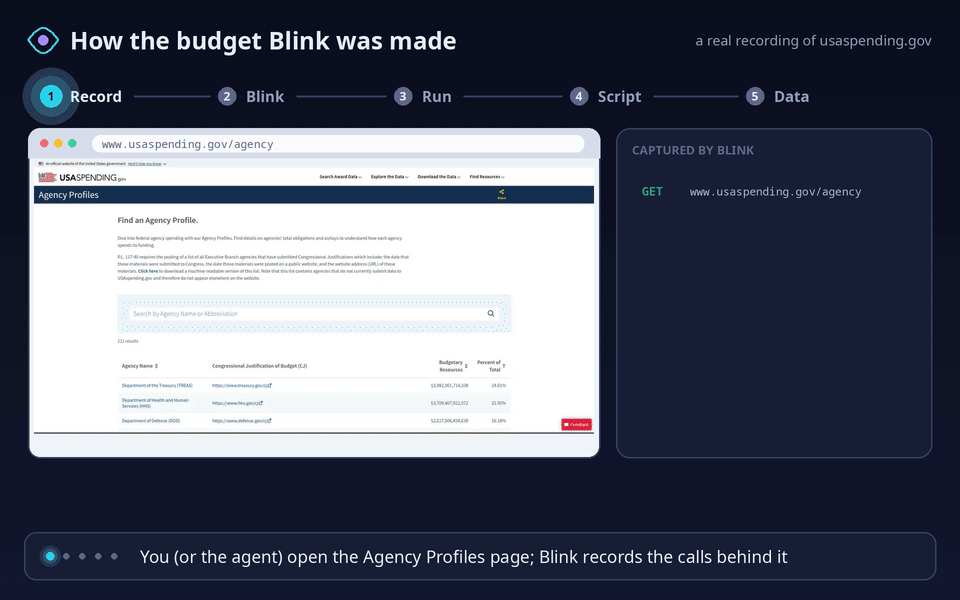
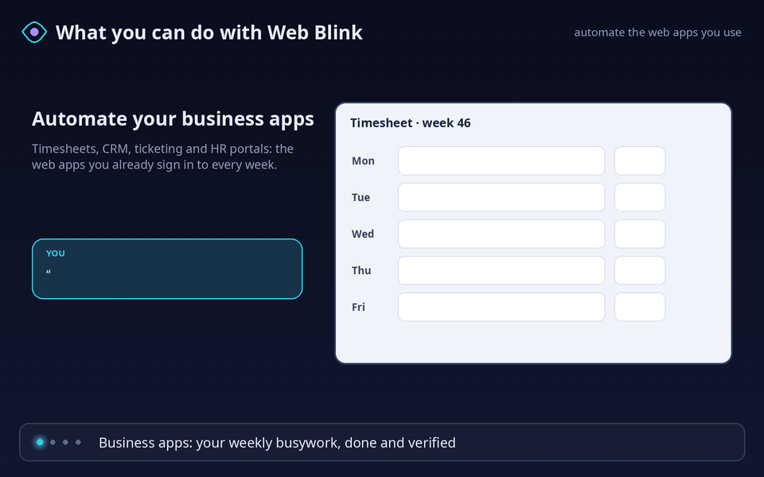
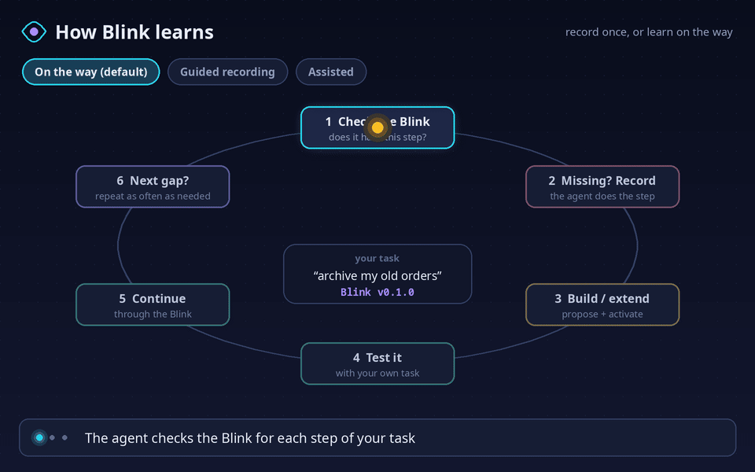
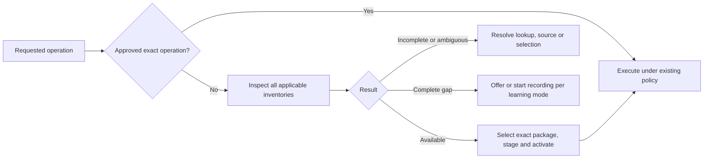

# Web Blink

It takes just a blink to control the web. Web Blink learns how web services and web apps work, then hands
them to you as reviewed, ready-to-run actions, so you can automate your work from Claude Code or the command
line (`web-blink`, or just `blink`).

<p align="center">
  
</p>

**Learn once, use it everywhere.** Blink watches how a web app talks to its backend while you (or the agent)
use it, and turns that into a reviewed, versioned **Blink**: named operations with their inputs, effects and
login recipe. Everything stays local in `~/.web-blink`. Load Blinks from your own Git repository, share them
with your team, then call them from your Claude Code or Codex sessions, or as plain CLI commands, scripts,
routines and schedules.

## Try it: latest NASA news

Read the newest NASA news releases from nasa.gov. No account, no browser, no setup beyond one tool.

**1. Install uv once** (a small tool that downloads Python and Web Blink for you). Skip this if you have it.

- macOS: open **Terminal** and run `curl -LsSf https://astral.sh/uv/install.sh | sh`
- Windows: open **PowerShell** and run `powershell -ExecutionPolicy ByPass -c "irm https://astral.sh/uv/install.ps1 | iex"`
- Linux: open a terminal and run `curl -LsSf https://astral.sh/uv/install.sh | sh`
  (no curl? see [uv's install page](https://docs.astral.sh/uv/getting-started/installation/))

Then quit the terminal app completely and open it again.

**2. Get the news:**

```sh
uvx --from https://github.com/patrick-1984/web-blink/archive/refs/tags/v0.18.2.zip blink add nasa-gov
uvx --from https://github.com/patrick-1984/web-blink/archive/refs/tags/v0.18.2.zip blink nasa-gov latest-news
```

The first run takes a few seconds while uv downloads everything. You see:

```text
Added the NASA news releases Blink (public, read-only). Next time it starts right away.
2026-11-08 10:26  NASA Announces $1 Million to Students for Moon Base Challenge
                  https://www.nasa.gov/news-release/nasa-announces-1-million-to-students-for-moon-base-challenge/

2026-11-07 17:47  NASA Awards Moon Base Transportation, Technology, Science Projects
                  https://www.nasa.gov/news-release/nasa-awards-moon-base-transportation-technology-science-projects/
```

**3. Only releases that mention the Moon** (anywhere in the article, not only the title), ten of them:

```sh
uvx --from https://github.com/patrick-1984/web-blink/archive/refs/tags/v0.18.2.zip blink nasa-gov latest-news --search moon --per-page 10
```

Why this is allowed: US federal websites are public by policy. The White House memo
[OMB M-23-22](https://www.whitehouse.gov/wp-content/uploads/2023/09/M-23-22-Delivering-a-Digital-First-Public-Experience.pdf)
says their content “may be crawled, archived, or ‘scraped’ by anyone in the general public, at any time”.

Tip: help and examples write commands as `blink …`. Until you install it (next steps), put the same
`uvx --from https://github.com/patrick-1984/web-blink/archive/refs/tags/v0.18.2.zip` in front, for example
`uvx --from https://github.com/patrick-1984/web-blink/archive/refs/tags/v0.18.2.zip blink nasa-gov latest-news --help`.

### Second example: the federal budget by agency

How much each federal agency has to spend this fiscal year, from USAspending.gov (a US Treasury site):

```sh
uvx --from https://github.com/patrick-1984/web-blink/archive/refs/tags/v0.18.2.zip blink add usaspending-gov
uvx --from https://github.com/patrick-1984/web-blink/archive/refs/tags/v0.18.2.zip blink usaspending-gov agency-budgets
```

```text
Agency                                      Budgetary resources   Share           Obligated  Fiscal year
Department of the Treasury                   $3,982,061,714,338  24.61%  $1,979,847,631,402  2026
Department of Health and Human Services      $3,709,407,922,072  22.92%  $2,803,832,148,218  2026
Department of Defense                        $2,617,506,434,639  16.18%  $1,538,724,925,218  2026
…
```

These are the same numbers the website's [Agency Profiles](https://www.usaspending.gov/agency) page shows. Sort
differently with `--sort budget_authority_amount`, `--sort agency_name` or `--order asc`.

**How this Blink was made.** Nobody wrote it by hand: it was learned from a real recording, the same way Blink
learns your own apps.

<p align="center">
  
</p>

1. **Record.** Blink opened usaspending.gov/agency in its own browser tab and recorded the 17 requests behind
   the page, from analytics to `api.usaspending.gov/api/v2/references/toptier_agencies/`, the call that fills
   the table.
2. **Blink.** That one call became the `usaspending-gov` Blink: one read operation, the page's own sort order as
   the default, and a check that it works without any login.
3. **Run.** `blink usaspending-gov agency-budgets` prints the table above.
4. **Script.** After a verified run, Blink saved the steps as a routine named `budget` and generated its script
   in `~/.web-blink/scripts/`.
5. **Data.** `blink routine run budget` gets the data any time; add `--confirmed --output json` in cron or a script.

For your own apps an agent does steps 1, 2 and 4 for you while you work: say “get the federal budget by agency”
in Claude Code or Codex, and next time the same phrase runs the saved routine.

### Third example: weather alerts

Active National Weather Service watches, warnings and advisories for a state:

```sh
uvx --from https://github.com/patrick-1984/web-blink/archive/refs/tags/v0.18.2.zip blink add weather-gov
uvx --from https://github.com/patrick-1984/web-blink/archive/refs/tags/v0.18.2.zip blink weather-gov active-alerts --area TX
```

```text
Alert                   Severity  Area                                        Until
Flood Advisory          Minor     Kimble, TX; Sutton, TX                      2026-11-09 18:45 -06:00
Flood Warning           Severe    Llano, TX                                   2026-11-10 01:15 -06:00
Rip Current Statement   Moderate  Aransas Islands; Kleberg Islands; Nueces …  2026-11-10 03:00 -06:00
…
```

Narrow it with `--severity Severe` or `--event "Flood Warning"`. A state is required: the whole-country list is too large for one call.

### Next steps

- Keep the `blink` command: `uv tool install https://github.com/patrick-1984/web-blink/archive/refs/tags/v0.18.2.zip`, then `uv tool update-shell`, then reopen the terminal app.
  From then on: `blink nasa-gov latest-news`.
- Scripts: add `--output json` for machine-readable results (see the [CLI reference](docs/cli-reference.md)).
- More Blinks that ship with Web Blink (NASA news, the federal budget, weather alerts, Claude Console, …): `uvx --from https://github.com/patrick-1984/web-blink/archive/refs/tags/v0.18.2.zip blink add` (or `blink add` once installed).
- Your own web apps: install the plugin (below) and ask Claude Code or Codex to do a task there. Blink learns
  the app while it works.

## What you can use it for

<p align="center">
  
</p>

- **Automate your business apps**: timesheets, CRM, ticketing, ERP and HR portals you already sign in to.
- **Apps without an API or MCP server**: Blink finds the calls behind the pages and exposes them as tools.
- **Scrape for private use**: turn pages you can see into clean JSON or CSV, within each site's terms.
- **From chat to script**: do a task once in a coding session, then rerun it as a verified routine or job.

## Install in Claude Code

From the [patrick-1984 plugin marketplace](https://github.com/patrick-1984/marketplace):

```text
/plugin marketplace add patrick-1984/marketplace
/plugin install web-blink@patrick-1984
```

Update an existing installation, then restart Claude Code:

```sh
claude plugin marketplace update patrick-1984
claude plugin update web-blink@patrick-1984
```

## Install in Codex

The same marketplace works in the Codex CLI:

```text
codex plugin marketplace add patrick-1984/marketplace
codex plugin add web-blink@patrick-1984
```

Update the marketplace and its installed plugin, then restart Codex to reload the files:

```sh
codex plugin marketplace upgrade patrick-1984
codex plugin add web-blink@patrick-1984
```

See the [Codex marketplace update documentation](https://developers.openai.com/plugins/build/plugins#add-a-marketplace-from-the-cli).
Web Blink registers no session or lifecycle hooks. Opening a Codex or Claude session does not run Blink
status checks or inspect your browser profiles.

Tell Blink which browser/profile to use, or reply with a numbered row such as **“use #6”**. It shows a
browser/profile table with real display names and aliases, remembers the choice and prepares needed local
components itself. You do not need to paste paths, run setup commands or edit configuration. Existing live
sessions, launching the selected existing profile through PW, an optional PW extension and a new persistent
PW browser are separate choices. See [browser connections](docs/browser-sessions.md).

When you ask to learn or record an app, Blink connects **and starts recording**, then guides you through
demonstrating the workflow. Opening a browser alone explicitly leaves recording off and offers the next step.
Switching browsers during setup keeps your original recording request. Optional consent waits apply only
to native Chrome/Edge profiles; other modes connect normally. See the [guided recording flow](docs/recording-flow.md).

Native Windows uses authenticated local named pipes; macOS/Linux use Unix sockets. Normal startup is
offline. A requested connection can prepare missing components in Blink's own folder; the host may ask to
authorize that tool action. Browser consent remains required, and shared-profile browser restart is blocked because it can affect other profiles.

Your order is the authorization: when you tell Claude to record, propose, switch a Blink on or submit something,
Blink adds no separate confirmation dialog by default. Codex or Claude can still ask permission to run a tool;
that permission belongs to the host and Blink cannot suppress it. Exact plans, budgets and reconciliation of
unknown outcomes still apply. If you want a dialog for every action, opt in yourself: `blink configure set
approvals dialog` (undo with `blink configure unset approvals`).

## Learning on the way (default)

<p align="center">
  
</p>


Just ask for the task, for example “in shop.example.net, list my open orders and archive the old ones”.
Blink uses an existing Blink when it has the operation. When it has none, it checks bundled, configured and official inventories before recording while the agent does
the step, builds or extends the Blink, tests it with your task, and continues through it; every later
missing step repeats this. Prefer learning only when you ask? `blink configure set learning on-request`.
For a missing schema, learning starts before the agent navigates or acts on the page. Plain Playwright
browsing is used only when you directly ask not to learn. Discovery, account, approval or setup blockers
keep the task pending; they never silently switch it to unrecorded browsing. With `on-request`, the agent
asks permission to learn. This routing is part of the plugin's agent instructions; Blink cannot intercept
a separate Playwright MCP tool.
Details: [on-the-way learning](docs/runtime-guide.md#on-the-way-learning-default).

- **Guided recording**: say “learn shop.example.net”, demonstrate the workflow once, and say “finished”.
- **Assisted learning**: when a step is missing and you would rather show it yourself, the agent hands you the
  recording tab for that one step, then carries on.
- **Git repositories**: install reviewed Blinks from your own or a shared repository; see [Git sources](docs/source-commands.md).

## What it is

Web Blink is a Claude plugin and scriptable CLI for reviewed, declarative integrations with web
services. Blinks live under `blinks/`. Everything Web Blink keeps for you lives in one private folder in
your home, `~/.web-blink` (`BLINK_HOME` selects another): runtime credentials, grants, journals and recordings
in `state/`, global and per-Blink CLI preferences in `config/`, and your private Blinks in `private/`.
`blink doctor` shows the folder. Data from older versions (`~/.local/state/web-blink` and
`~/.config/web-blink`, or `WebBlink` on macOS and Windows) moves there once, by itself, when no daemon is using
it; the old folder keeps a `MOVED-TO-web-blink.txt` note.

```sh
blink --help
blink doctor
blink configure set output json
blink configure set region europe --blink team:timesheets
blink team:timesheets submit-hours --body file://hours.json --request-id hours-2026-10-27 --yes
```

The timesheet name illustrates an integration you install or learn; it is not a bundled live connector.
Use `--dry-run` to validate a local plan without dispatch, and stable request IDs to resume a script safely.
Writes need an exact native approval; unknown outcomes retain their intent and budget for reconciliation.
Successful dispatch is labelled accepted/unverified. `blink_verify` checks explicit expectations through
reviewed reads; writes require correlated read-back and never repeat a mutation for verification.
Activation exposes nested parameter schemas before changes; failures retain sanitized stage/field, HTTP
status and dispatch evidence. Public reads with incidental cookies can use explicit credential-free checks
before anonymous classification. See the [execution contract](docs/execution-profile.md).

Each Blink also has a **private Blink** for you alone: your login name, field defaults ("leave PTO empty"),
preferences and process notes ("fill weeks Monday to Friday"), plus optional secrets kept in a separate file.
It lives in `$BLINK_HOME/private/<blink>.json` (default `~/.web-blink`, files 0600, folder 0700), is never
shared with the Blink, and Claude reads it before preparing writes. Tell Claude your preference and it saves it
(`private_set`); `blink admin --input '{"action": "private", "service": "local:<blink>"}'` shows it without secret values.

An order to use an existing Blink starts **execution mode** without recording: it remembers private account
contexts, tries the known login headlessly and cleans up before a visible, prefilled login handoff when needed.
Learned phrases can become private, verified routines backed by deterministic CLI scripts with millisecond
pacing. A known routine asks once whether to follow its last rules; previews appear only when requested.
See [Execution mode and routines](docs/runtime-guide.md#execution-mode).

- [Result verification](docs/result-verification.md): expected versus observed checks, correlated write read-back and pending outcomes.
- [Runtime guide](docs/runtime-guide.md): setup, accounts, learning, execution and schedules.
- [Use existing browser logins](docs/browser-sessions.md): select Chrome, Edge or Brave profiles, keep personal/admin accounts separate, and discover Firefox profiles.
- [CLI reference](docs/cli-reference.md): command grammar, scripting, defaults and precedence.
- [Execution profile](docs/execution-profile.md): supported request/auth/quote formats and limits.
- [Git sources](docs/source-commands.md): immutable imports, local trust and publisher verification.
- [Custody providers](docs/custody-provider.md): isolated harvest, C4 permission and fenced hand-back.
- [State cleanup](docs/state-lifecycle.md): forget/purge and retained unknown-outcome evidence.
- Troubleshooting: when something fails, Claude diagnoses it on the spot and can file an anonymized problem report (you review it first).
- [Claude compatibility](docs/claude-compatibility.md): official plugin layout and host support.
- [Blinks](blinks/README.md) and [schema index](schemas/index.json): versioned portable interaction files.

Load the extracted plugin directory with `claude --plugin-dir /absolute/path/to/web-blink`.
The Node MCP entry supports diagnostics without Python. Prepare locked runtime dependencies explicitly:

```sh
uv run --no-project --with-requirements /absolute/path/to/web-blink/requirements.lock python -c "import jsonschema"
```

The MCP launcher stays offline afterward. The current daemon runs on POSIX hosts; Windows diagnostics
remain available. Default shared-browser use is through the existing Playwright MCP, with owned tabs only.
Isolated custody needs a provider that proves its capabilities; the shared main profile is never harvested.

In a source checkout, `uv run web-blink ...` (or the alias `uv run blink ...`) works from the repository
root. The checkout also contains tests and tools. Release builds exclude tests, private runtime state and caches.

Run a synthetic local CLI/MCP demonstration (no real account or external service):

```sh
uv run -q --project . python scripts/demo.py
```

### Find a Blink before recording

`blink find entra.microsoft.com` and MCP `blink_find` inspect installed, pending, bundled and configured/official
catalogs. An available package is staged and activated exactly; incomplete checks keep recording off. Use
`blink add NAME` before the first use of a bundled Blink. See [discovery and local repositories](docs/source-commands.md#discovery-before-recording).


