# Web Blink: Interaction and Lifecycle Flow Map

Generated by `tools/check_flows.py` from `design/flows.json`; do not edit by hand.

Validation: **passed**. 26 entities; 286/286 exact transitions exercised by 52 ordered scenarios and 105 isolated edge examples.

Checks cover full transition identity (including trigger and actor), state progression per instance, valid initial states, declared linked-instance prerequisites and matching scopes. Every modelled state is reachable from creation and has some graph path to a terminal state.

**Limits:** initial states and matching scope labels are scenario assumptions. Edge examples exercise one transition, not an integrated workflow. Existential graph reachability does not prove eventual cleanup, global completeness, transaction atomicity, actual provider behavior or runtime enforcement. Human action, deadlines, fair scheduling and successful storage are not proven. Recovery contracts below are implementation requirements, not measured results.

## Component interaction graph

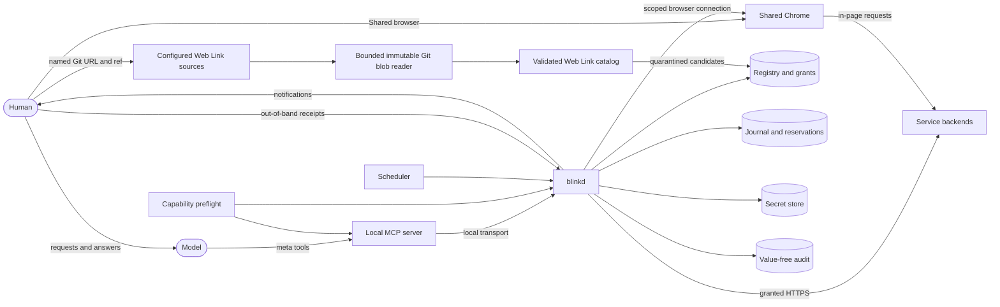

## Entity lifecycles

### PreflightSentinel

cached result of static environment checks (AD-19)

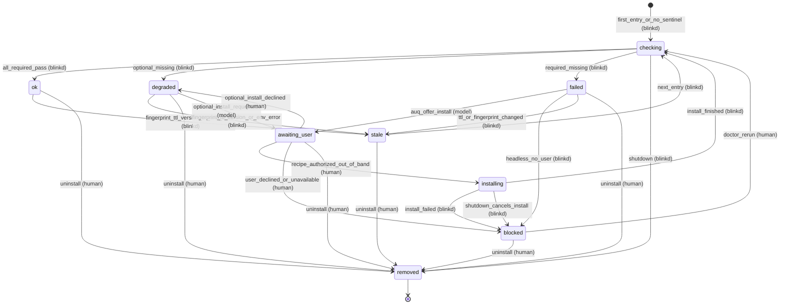

Recovery contract: **owner**: blinkd, with human resolution where noted; **deadline**: before the next dispatch after restart; human waits remain parked and notified; **restart**: reconcile durable state before permitting affected work; **disposition**: follow terminal paths; failed cleanup is retried and reported

Declared prerequisites:

- `awaiting_user>installing:recipe_authorized_out_of_band@human`: linked `installation` (ApprovalReceipt) in consumed, same scope

### UserQuestion

an AskUserQuestion prompt (AD-20)

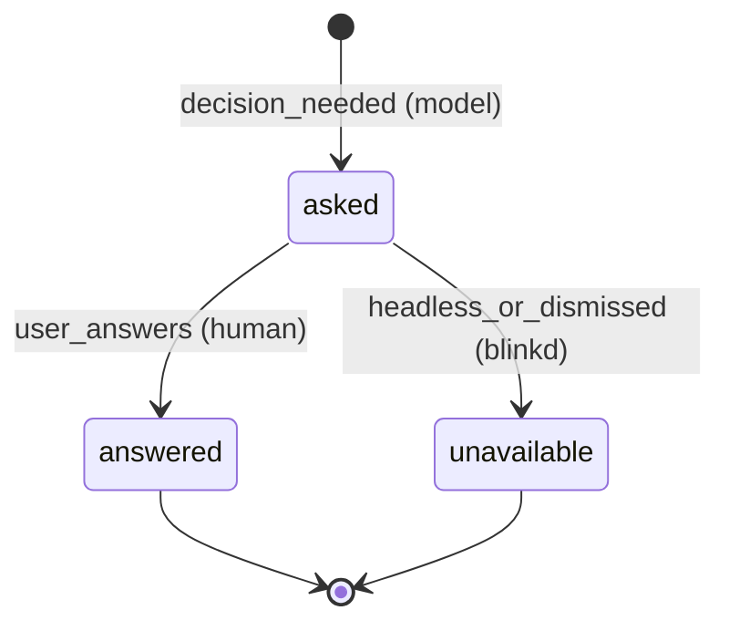

Recovery contract: **owner**: blinkd, with human resolution where noted; **deadline**: before the next dispatch after restart; human waits remain parked and notified; **restart**: reconcile durable state before permitting affected work; **disposition**: follow terminal paths; failed cleanup is retried and reported

### Notification

human notification (park, expiry forecast, preflight block)

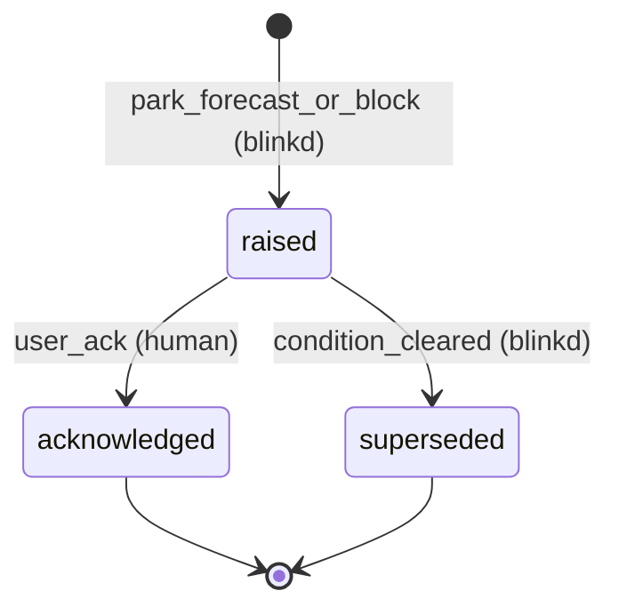

Recovery contract: **owner**: blinkd, with human resolution where noted; **deadline**: before the next dispatch after restart; human waits remain parked and notified; **restart**: reconcile durable state before permitting affected work; **disposition**: follow terminal paths; failed cleanup is retried and reported

### CaptureSession

recorded learning session (AD-17)

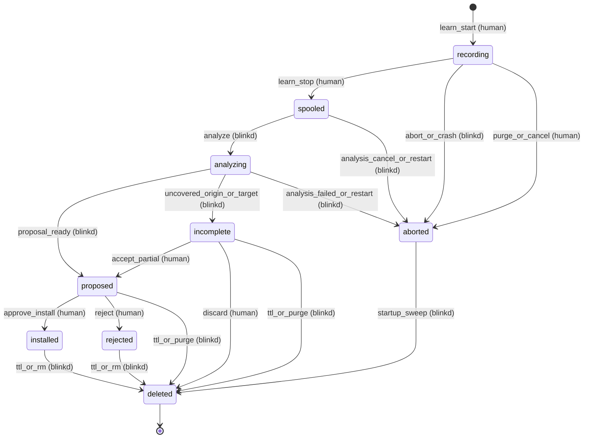

Recovery contract: **owner**: blinkd, with human resolution where noted; **deadline**: startup sweep before learning resumes; redacted spools expire after 30 days by default; **restart**: abort recording, spooled or analyzing captures; delete aborted artifacts; **disposition**: drop raw memory immediately; remove redacted spool on TTL or explicit purge

### RawRunBuffer

in-memory raw values of a live capture

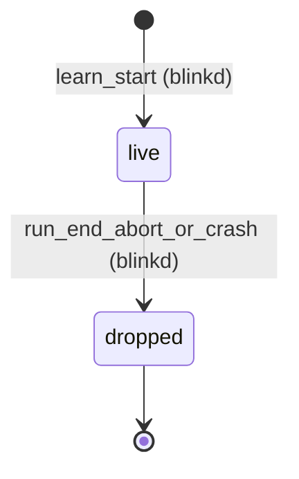

Recovery contract: **owner**: blinkd, with human resolution where noted; **deadline**: before the next dispatch after restart; human waits remain parked and notified; **restart**: reconcile durable state before permitting affected work; **disposition**: follow terminal paths; failed cleanup is retried and reported

### ManifestOp

one learned operation + lockfile digest (AD-6, AD-15)

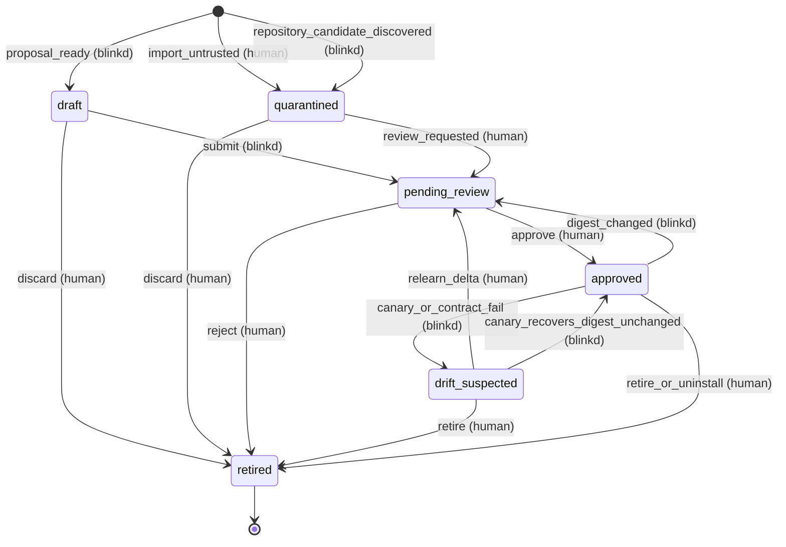

Recovery contract: **owner**: blinkd, with human resolution where noted; **deadline**: before the next dispatch after restart; human waits remain parked and notified; **restart**: reconcile durable state before permitting affected work; **disposition**: follow terminal paths; failed cleanup is retried and reported

### Grant

credential->origin/op grant (AD-4)

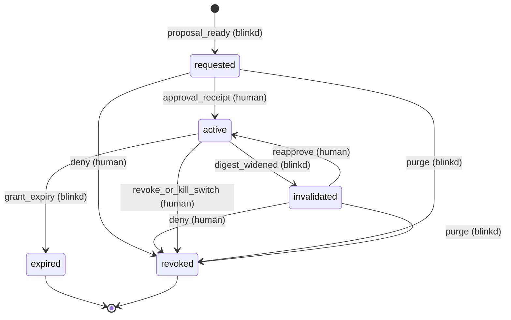

Recovery contract: **owner**: blinkd, with human resolution where noted; **deadline**: before the next dispatch after restart; human waits remain parked and notified; **restart**: reconcile durable state before permitting affected work; **disposition**: follow terminal paths; failed cleanup is retried and reported

### AccountBinding

service x account x tenant (AD-5)

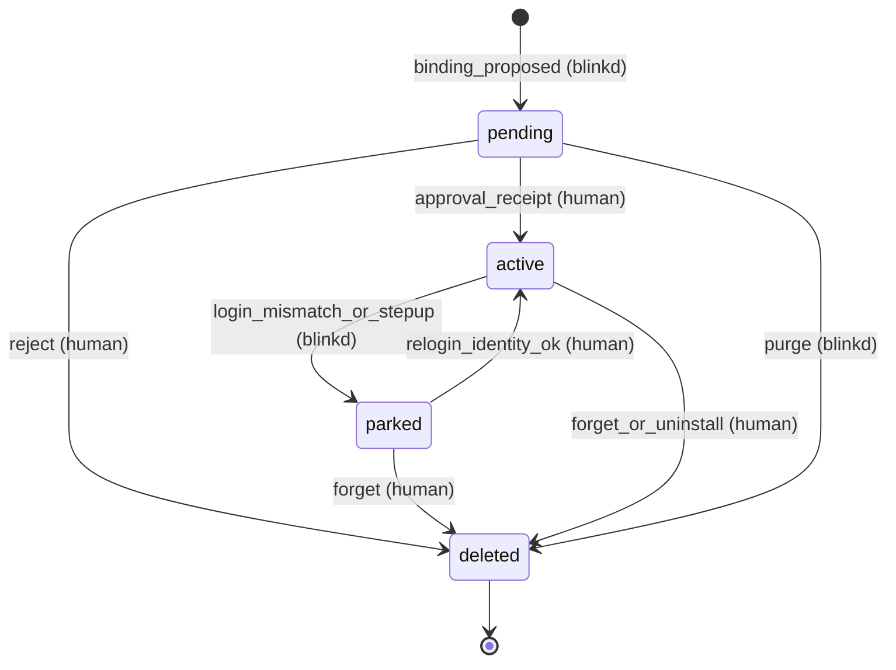

Recovery contract: **owner**: blinkd, with human resolution where noted; **deadline**: before the next dispatch after restart; human waits remain parked and notified; **restart**: reconcile durable state before permitting affected work; **disposition**: follow terminal paths; failed cleanup is retried and reported

### Custody

One binding x operation custody selection (C1-C5); a mixed binding uses distinct instances. Shared credential-family ownership must remain exclusive.

```mermaid
stateDiagram-v2
  [*] --> unassigned: binding_proposed (blinkd)
  unassigned --> eligibility_check: custody_requested (human)
  unassigned --> revoked: binding_deleted (blinkd)
  eligibility_check --> c1: browser_live_chosen_or_required (human)
  eligibility_check --> c2: browser_on_demand_chosen (human)
  eligibility_check --> c3: eligible_c3_receipt_valid (human)
  eligibility_check --> c4: eligible_c4_and_separate_authorization (human)
  eligibility_check --> c5: official_broker_grant_approved (human)
  eligibility_check --> revoked: decline_or_cancel (human)
  c1 --> eligibility_check: switch_requested (human)
  c2 --> eligibility_check: switch_requested (human)
  c3 --> transferring: future_calls_handback_requested (human)
  c4 --> transferring: future_calls_handback_requested (human)
  c3 --> parked: refresh_unknown_or_expired (blinkd)
  c4 --> parked: refresh_unknown_or_expired (blinkd)
  c5 --> parked: refresh_unknown_or_expired (blinkd)
  c1 --> parked: browser_login_required (blinkd)
  c2 --> parked: browser_login_required (blinkd)
  c3 --> human_required: challenge_mismatch_or_stepup (blinkd)
  c4 --> human_required: challenge_mismatch_or_stepup (blinkd)
  c5 --> human_required: challenge_mismatch_or_stepup (blinkd)
  c1 --> human_required: challenge_mismatch_or_stepup (blinkd)
  c2 --> human_required: challenge_mismatch_or_stepup (blinkd)
  c4 --> reharvesting: future_unsent_call_authorized_reseed (blinkd)
  reharvesting --> c4: identity_checked_generation_committed (blinkd)
  reharvesting --> human_required: login_mfa_challenge_or_mismatch (blinkd)
  reharvesting --> parked: browser_refused_or_unavailable (blinkd)
  parked --> eligibility_check: human_relogin_and_recheck (human)
  human_required --> eligibility_check: human_resolved_and_recheck (human)
  transferring --> c1: browser_owner_epoch_committed (blinkd)
  transferring --> c3: reconciled_broker_c3_owner (blinkd)
  transferring --> c4: reconciled_broker_c4_owner (blinkd)
  c1 --> revoked: forget_after_quiesce (human)
  c2 --> revoked: forget_after_quiesce (human)
  c3 --> revoked: forget_after_quiesce (human)
  c4 --> revoked: forget_after_quiesce (human)
  c5 --> revoked: forget_after_quiesce (human)
  parked --> revoked: forget_after_quiesce (human)
  human_required --> revoked: forget_after_quiesce (human)
  reharvesting --> revoked: forget_after_quiesce (human)
  transferring --> revoked: forget_after_quiesce (human)
  revoked --> [*]
```

Recovery contract: **owner**: blinkd, with human resolution where noted; **deadline**: before the next dispatch after restart; human waits remain parked and notified; **restart**: reconcile durable state before permitting affected work; **disposition**: follow terminal paths; failed cleanup is retried and reported

Declared prerequisites:

- `eligibility_check>c3:eligible_c3_receipt_valid@human`: linked `eligibility` (OperationEligibility) in detachable, same scope; linked `approval` (ApprovalReceipt) in issued, same scope
- `eligibility_check>c4:eligible_c4_and_separate_authorization@human`: linked `eligibility` (OperationEligibility) in detachable, same scope; linked `approval` (ApprovalReceipt) in issued, same scope; linked `reharvest` (ReharvestAuthorization) in active, same scope
- `eligibility_check>c5:official_broker_grant_approved@human`: linked `approval` (ApprovalReceipt) in issued, same scope
- `c4>reharvesting:future_unsent_call_authorized_reseed@blinkd`: linked `reharvest` (ReharvestAuthorization) in active, same scope; linked `eligibility` (OperationEligibility) in detachable, same scope
- `reharvesting>c4:identity_checked_generation_committed@blinkd`: linked `generation` (CredentialGeneration) in current, same scope
- `transferring>c1:browser_owner_epoch_committed@blinkd`: linked `transfer` (OwnershipTransfer) in committed, same scope
- `transferring>c3:reconciled_broker_c3_owner@blinkd`: linked `transfer` (OwnershipTransfer) in broker_recovered, same scope
- `transferring>c4:reconciled_broker_c4_owner@blinkd`: linked `transfer` (OwnershipTransfer) in broker_recovered, same scope; linked `reharvest` (ReharvestAuthorization) in active, same scope; linked `eligibility` (OperationEligibility) in detachable, same scope

### CredentialGeneration

One atomic durable credential bundle. New generations invalidate identity evidence; only identity-matched generations become current.

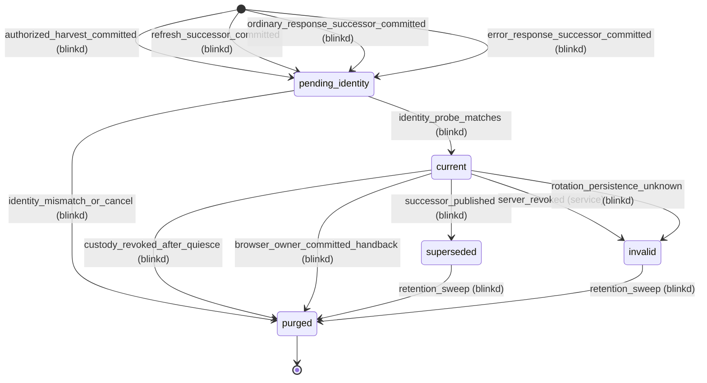

Recovery contract: **owner**: blinkd, with human resolution where noted; **deadline**: before the next dispatch after restart; human waits remain parked and notified; **restart**: load only committed generation and owner epoch; fence unknown rotations; **disposition**: purge superseded/revoked material only after successor or owner commit; secrets excluded from exports

Declared prerequisites:

- `new>pending_identity:authorized_harvest_committed@blinkd`: linked `custody` (Custody) in c3, c4, c5, reharvesting, same scope; linked `approval` (ApprovalReceipt) in consumed, same scope
- `new>pending_identity:refresh_successor_committed@blinkd`: linked `update` (CredentialUpdate) in persisted, same scope; linked `custody` (Custody) in c3, c4, c5, same scope
- `new>pending_identity:ordinary_response_successor_committed@blinkd`: linked `update` (CredentialUpdate) in persisted, same scope; linked `custody` (Custody) in c3, c4, c5, same scope
- `new>pending_identity:error_response_successor_committed@blinkd`: linked `update` (CredentialUpdate) in persisted, same scope; linked `custody` (Custody) in c3, c4, c5, same scope
- `current>superseded:successor_published@blinkd`: linked `successor` (CredentialGeneration) in current, same scope, distinct instance
- `current>purged:browser_owner_committed_handback@blinkd`: linked `transfer` (OwnershipTransfer) in committed, same scope
- `current>purged:custody_revoked_after_quiesce@blinkd`: linked `custody` (Custody) in revoked, same scope
- `pending_identity>current:identity_probe_matches@blinkd`: linked `custody` (Custody) in c3, c4, c5, reharvesting, same scope

### RefreshAttempt

journaled refresh (AD-16a #2)

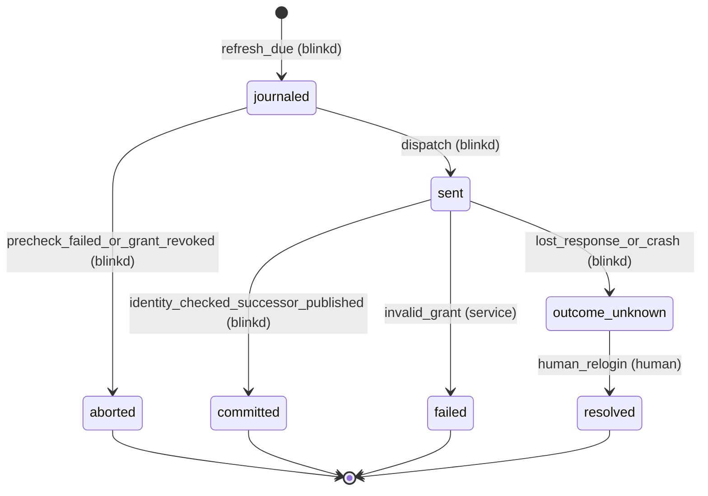

Recovery contract: **owner**: blinkd, with human resolution where noted; **deadline**: before the next dispatch after restart; human waits remain parked and notified; **restart**: reconcile durable state before permitting affected work; **disposition**: follow terminal paths; failed cleanup is retried and reported

Declared prerequisites:

- `sent>committed:identity_checked_successor_published@blinkd`: linked `generation` (CredentialGeneration) in current, same scope

### BrowserContext

isolated harvest context or Blink profile (AD-16a #4, #6)

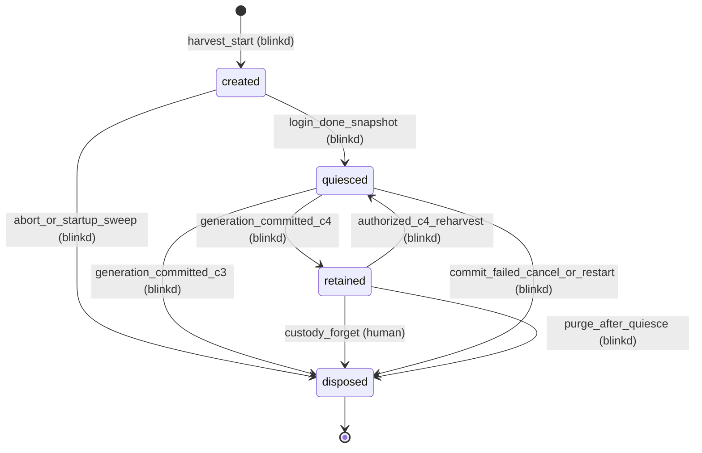

Recovery contract: **owner**: blinkd, with human resolution where noted; **deadline**: before the next dispatch after restart; human waits remain parked and notified; **restart**: dispose created/quiesced leftovers unless a durable C4 retention commit exists; never adopt another session context; **disposition**: C3 temporary context disposed; C4 retained profile requires explicit forget/purge

Declared prerequisites:

- `retained>quiesced:authorized_c4_reharvest@blinkd`: linked `custody` (Custody) in reharvesting, same scope; linked `reharvest` (ReharvestAuthorization) in active, same scope
- `quiesced>disposed:generation_committed_c3@blinkd`: linked `generation` (CredentialGeneration) in current, same scope
- `quiesced>retained:generation_committed_c4@blinkd`: linked `generation` (CredentialGeneration) in current, same scope

### WorkTab

Blink-owned tab right of tab 0 (AD-14)

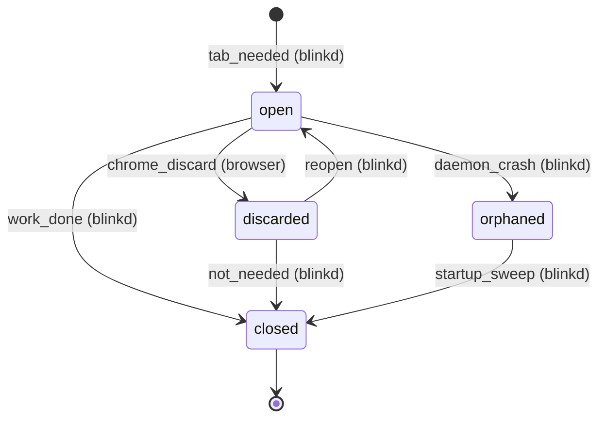

Recovery contract: **owner**: blinkd, with human resolution where noted; **deadline**: before the next dispatch after restart; human waits remain parked and notified; **restart**: reconcile durable state before permitting affected work; **disposition**: follow terminal paths; failed cleanup is retried and reported

### Intent

non-read business attempt + journal (AD-10/10a)

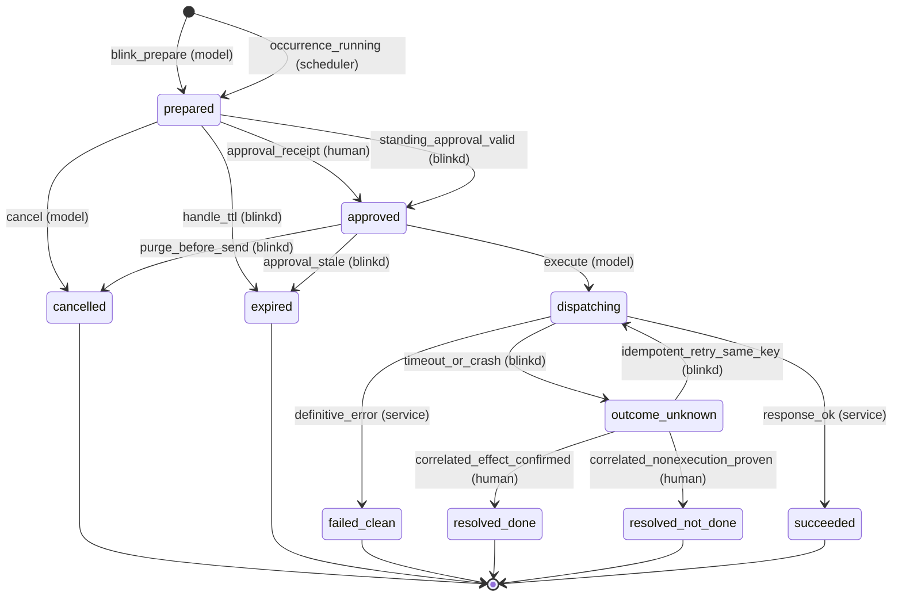

Recovery contract: **owner**: blinkd, with human resolution where noted; **deadline**: before the next dispatch after restart; human waits remain parked and notified; **restart**: dispatching becomes outcome_unknown; reuse stable intent/key only under proven idempotency contract; **disposition**: unknown effects preserve journal; no unsent-job fallback retries a dispatched intent

### SpendReservation

atomic budget reservation (review-2 delta 1)

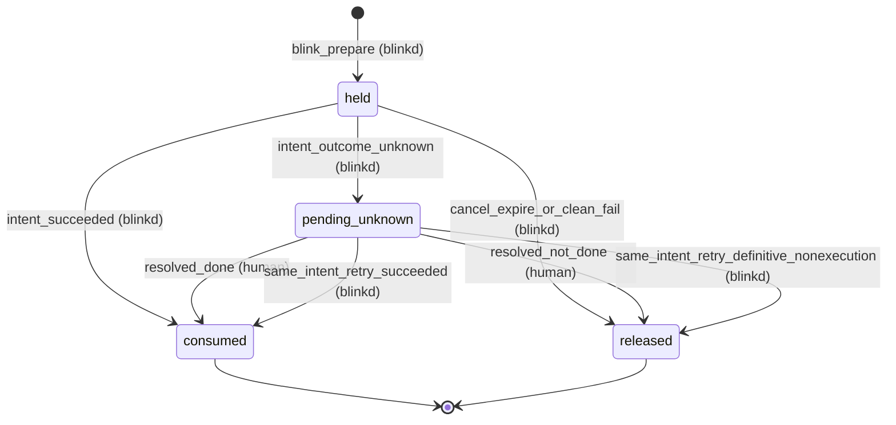

Recovery contract: **owner**: blinkd, with human resolution where noted; **deadline**: before the next dispatch after restart; human waits remain parked and notified; **restart**: restore held/pending reservations; settle transactionally once per same intent/key; **disposition**: unknown effects keep budget reserved; definitive correlated outcome consumes or releases once

Declared prerequisites:

- `held>consumed:intent_succeeded@blinkd`: linked `intent` (Intent) in succeeded, same scope
- `held>released:cancel_expire_or_clean_fail@blinkd`: linked `intent` (Intent) in cancelled, expired, failed_clean, same scope
- `held>pending_unknown:intent_outcome_unknown@blinkd`: linked `intent` (Intent) in outcome_unknown, same scope
- `pending_unknown>consumed:resolved_done@human`: linked `intent` (Intent) in resolved_done, same scope
- `pending_unknown>released:resolved_not_done@human`: linked `intent` (Intent) in resolved_not_done, same scope
- `pending_unknown>consumed:same_intent_retry_succeeded@blinkd`: linked `intent` (Intent) in succeeded, same scope
- `pending_unknown>released:same_intent_retry_definitive_nonexecution@blinkd`: linked `intent` (Intent) in failed_clean, same scope

### ApprovalReceipt

out-of-band human approval (review-2 delta 2)

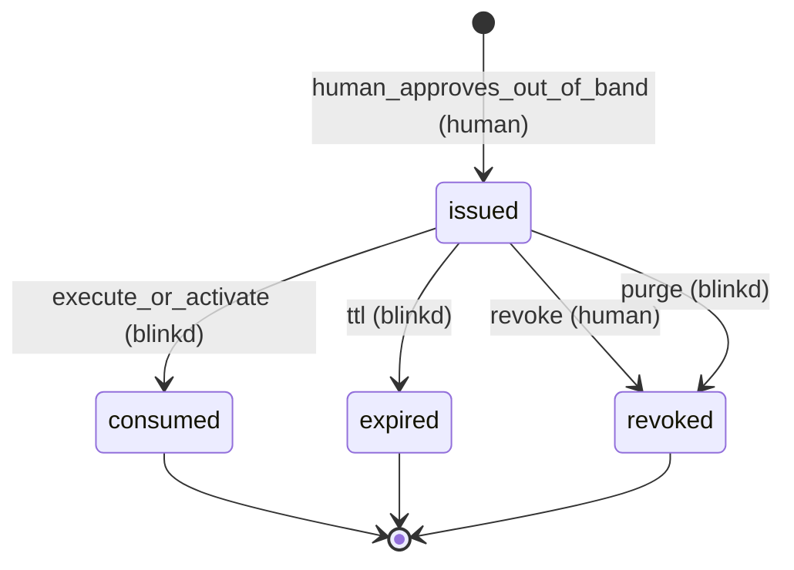

Recovery contract: **owner**: blinkd, with human resolution where noted; **deadline**: before the next dispatch after restart; human waits remain parked and notified; **restart**: reconcile durable state before permitting affected work; **disposition**: follow terminal paths; failed cleanup is retried and reported

### Job

scheduled job with standing approval (section 10)

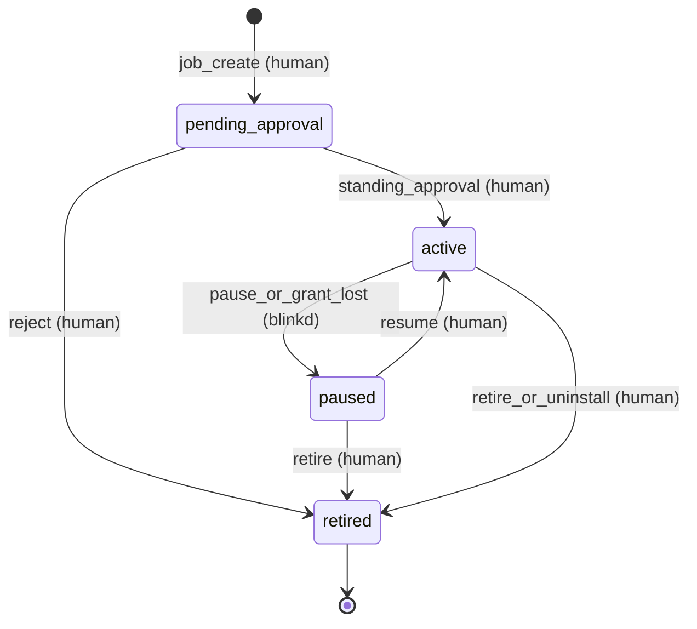

Recovery contract: **owner**: blinkd, with human resolution where noted; **deadline**: before the next dispatch after restart; human waits remain parked and notified; **restart**: reconcile durable state before permitting affected work; **disposition**: follow terminal paths; failed cleanup is retried and reported

### Occurrence

One scheduled run. parked is unsent only; awaiting_reconciliation retains a dispatched intent and cannot be scheduled as new work.

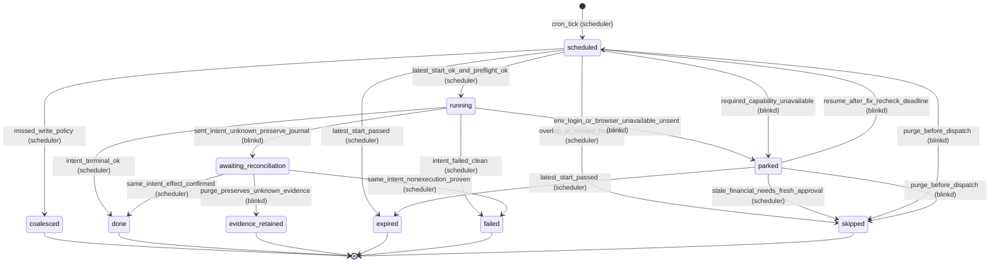

Recovery contract: **owner**: blinkd, with human resolution where noted; **deadline**: before the next dispatch after restart; human waits remain parked and notified; **restart**: reconcile durable state before permitting affected work; **disposition**: follow terminal paths; failed cleanup is retried and reported

Declared prerequisites:

- `running>awaiting_reconciliation:sent_intent_unknown_preserve_journal@blinkd`: linked `intent` (Intent) in outcome_unknown, same scope
- `awaiting_reconciliation>done:same_intent_effect_confirmed@scheduler`: linked `intent` (Intent) in succeeded, resolved_done, same scope
- `awaiting_reconciliation>failed:same_intent_nonexecution_proven@scheduler`: linked `intent` (Intent) in failed_clean, resolved_not_done, same scope
- `awaiting_reconciliation>evidence_retained:purge_preserves_unknown_evidence@blinkd`: linked `intent` (Intent) in outcome_unknown, same scope; linked `purge` (PurgeRun) in cleaning, same scope

### OperationEligibility

Eligibility for one binding x operation x execution mode; unknown telemetry never permits detachable execution.

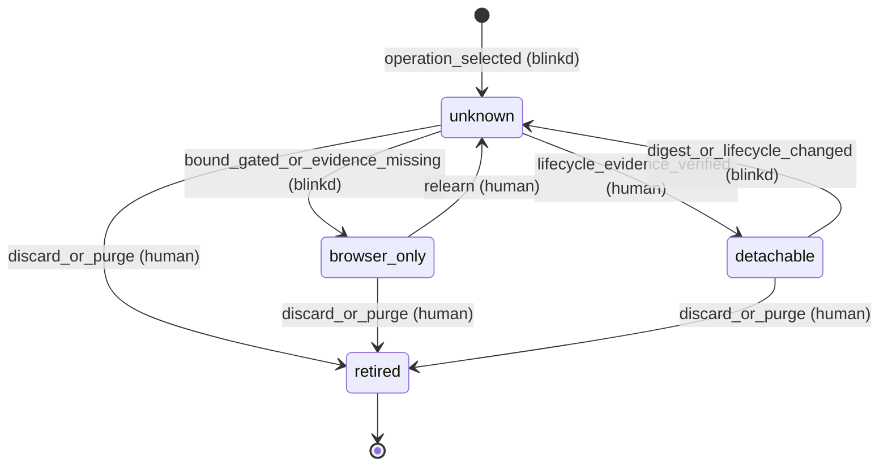

Recovery contract: **owner**: blinkd, with human resolution where noted; **deadline**: before the next dispatch after restart; human waits remain parked and notified; **restart**: reconcile durable state before permitting affected work; **disposition**: follow terminal paths; failed cleanup is retried and reported

### ReharvestAuthorization

Separate, revocable C4 authorization scoped to binding, family and selected operation. A C3 authorization cannot imply it.

```mermaid
stateDiagram-v2
  [*] --> active: human_authorizes_c4_out_of_band (human)
  active --> revoked: revoke_or_purge (human)
  active --> expired: authorization_expiry (blinkd)
  expired --> [*]
  revoked --> [*]
```

Recovery contract: **owner**: blinkd, with human resolution where noted; **deadline**: before the next dispatch after restart; human waits remain parked and notified; **restart**: reconcile durable state before permitting affected work; **disposition**: follow terminal paths; failed cleanup is retried and reported

### OwnershipTransfer

Durable owner-epoch transfer. Stop maintenance and fence both owners before reseeding; retain broker generation until browser ownership commits.

```mermaid
stateDiagram-v2
  [*] --> fenced: maintenance_stopped_and_epoch_fenced (blinkd)
  fenced --> reseeded: browser_snapshot_written (blinkd)
  reseeded --> committed: browser_verified_owner_epoch_committed (blinkd)
  committed --> complete: broker_copy_purged (blinkd)
  fenced --> unknown: crash_or_reseed_failure (blinkd)
  reseeded --> unknown: crash_before_owner_commit (blinkd)
  unknown --> committed: restart_proves_browser_owner (blinkd)
  unknown --> broker_recovered: restart_proves_broker_owner (blinkd)
  unknown --> revoked: human_revokes_both_owners (human)
  fenced --> revoked: revoke_both_owners (human)
  broker_recovered --> [*]
  complete --> [*]
  revoked --> [*]
```

Recovery contract: **owner**: blinkd, with human resolution where noted; **deadline**: before either owner resumes refresh or calls; **restart**: reconcile durable epoch and verified browser owner; otherwise stop for human; **disposition**: keep recoverable broker bundle until browser ownership commits; revoke both on explicit cancellation

Declared prerequisites:

- `new>fenced:maintenance_stopped_and_epoch_fenced@blinkd`: linked `custody` (Custody) in transferring, same scope
- `committed>complete:broker_copy_purged@blinkd`: linked `generation` (CredentialGeneration) in purged, same scope

### CredentialUpdate

Serialized family update from refresh, ordinary or error response. Journal before send; expected-generation compare-and-commit rejects stale replies.

```mermaid
stateDiagram-v2
  [*] --> locked: family_lock_acquired (blinkd)
  locked --> journaled: write_ahead_with_base_generation (blinkd)
  locked --> released: precheck_failed_unlock (blinkd)
  journaled --> sent: dispatch_under_family_lock (blinkd)
  journaled --> released: cancel_before_send (blinkd)
  sent --> response_ready: refresh_response_rotates (service)
  sent --> response_ready: ordinary_response_rotates (service)
  sent --> response_ready: error_response_rotates (service)
  sent --> unknown: response_lost_or_restart (blinkd)
  response_ready --> persisted: atomic_expected_generation_commit (blinkd)
  response_ready --> stale: base_generation_changed (blinkd)
  response_ready --> unknown: crash_before_durable_commit (blinkd)
  persisted --> released: identity_and_publication_complete_unlock (blinkd)
  stale --> released: reject_stale_reply_unlock (blinkd)
  unknown --> parked: fence_and_invalidate_identity (blinkd)
  parked --> [*]
  released --> [*]
```

Recovery contract: **owner**: blinkd, with human resolution where noted; **deadline**: before the next dispatch after restart; human waits remain parked and notified; **restart**: reconcile durable state before permitting affected work; **disposition**: follow terminal paths; failed cleanup is retried and reported

Declared prerequisites:

- `persisted>released:identity_and_publication_complete_unlock@blinkd`: linked `generation` (CredentialGeneration) in current, purged, same scope

### UserCheck

User-added dependency check configuration; included in checkSetHash and service/purge inventory.

```mermaid
stateDiagram-v2
  [*] --> active: tools_add (human)
  active --> removed: tools_remove_or_purge (human)
  removed --> [*]
```

Recovery contract: **owner**: blinkd, with human resolution where noted; **deadline**: before the next dispatch after restart; human waits remain parked and notified; **restart**: reconcile durable state before permitting affected work; **disposition**: follow terminal paths; failed cleanup is retried and reported

### PurgeRun

Forget/uninstall protocol. Sensitive material is removed after quiescing; ambiguous business evidence is retained explicitly rather than silently erased.

```mermaid
stateDiagram-v2
  [*] --> quiescing: forget_or_uninstall_requested (human)
  quiescing --> cleaning: jobs_and_maintenance_stopped (blinkd)
  cleaning --> complete: all_durable_artifacts_disposed_no_unknowns (blinkd)
  cleaning --> evidence_retained: unknown_intents_and_reservations_preserved (blinkd)
  quiescing --> blocked: cannot_confirm_dispatch_stopped (blinkd)
  cleaning --> blocked: deletion_failed (blinkd)
  blocked --> quiescing: retry_after_restart_or_fix (human)
  complete --> [*]
  evidence_retained --> [*]
```

Recovery contract: **owner**: blinkd, with human resolution where noted; **deadline**: before the next dispatch after restart; human waits remain parked and notified; **restart**: resume quiesce then deletion; failures stay blocked with notification; **disposition**: inventory includes registry, bindings, grants, credentials, retained profiles, captures, tabs, user checks, sentinel, receipts, jobs, occurrences, intents, reservations and journals; preserve ambiguous evidence without secrets

### CatalogSource

User-configured named HTTPS Git URL, ref and catalogPath. Each check resolves one immutable commit and reads only bounded regular blobs from that snapshot. Source availability does not change previously approved installed pins.

```mermaid
stateDiagram-v2
  [*] --> configured: user_adds_named_git_url_ref_catalog (human)
  configured --> checking: resolve_immutable_commit_and_read_bounded_catalog (blinkd)
  ready --> checking: user_or_scheduled_source_check (blinkd)
  degraded --> checking: retry_source_check (blinkd)
  checking --> ready: catalog_snapshot_schema_paths_digests_valid (blinkd)
  checking --> degraded: resolution_fetch_or_catalog_validation_failed (blinkd)
  ready --> configured: user_edits_source_configuration (human)
  configured --> removed: user_removes_source (human)
  checking --> removed: user_removes_source_cancel_check (human)
  ready --> removed: user_removes_source (human)
  degraded --> removed: user_removes_source (human)
  removed --> [*]
```

Recovery contract: **owner**: blinkd source reader; user owns source configuration; **deadline**: bounded source check timeout; no source operation blocks use of an approved local pin; **restart**: discard incomplete temporary reads, retain configured source and last approved immutable snapshots; **disposition**: source removal stops updates and deletes temporary fetch state; installed pinned Web Links remain until explicitly retired

### SourceCandidate

One Web Link candidate from one source/integration at an immutable Git commit. Quarantine is the initial trust state. This local lifecycle cannot grant origins, raise local trust, execute repository code or alter installed approvals.

```mermaid
stateDiagram-v2
  [*] --> quarantined: bounded_immutable_snapshot_staged (blinkd)
  quarantined --> validated: schemas_paths_and_content_digests_valid (blinkd)
  quarantined --> rejected: schema_path_digest_or_blob_validation_failed (blinkd)
  validated --> pending_review: new_or_changed_execution_semantics (blinkd)
  validated --> staged: unchanged_semantic_digest_and_existing_pin_valid (blinkd)
  pending_review --> staged: scoped_human_receipt_and_manifest_approval_valid (blinkd)
  pending_review --> rejected: human_rejects (human)
  staged --> activated: atomic_activation_expected_old_digest_cas_matches (blinkd)
  staged --> rejected: expected_old_digest_cas_failed (blinkd)
  staged --> rejected: staging_ttl_source_removed_or_reconfigured (blinkd)
  quarantined --> deleted: user_discards_candidate (human)
  validated --> deleted: user_cancels_candidate (human)
  rejected --> deleted: staging_cleanup (blinkd)
  quarantined --> rejected: staging_ttl_expired_or_source_removed (blinkd)
  validated --> rejected: staging_ttl_expired_or_source_removed (blinkd)
  pending_review --> rejected: staging_ttl_expired_or_source_removed (blinkd)
  activated --> [*]
  deleted --> [*]
```

Recovery contract: **owner**: blinkd source reader and registry; human approves semantic changes out of band; **deadline**: candidate staging TTL or explicit discard; expired authorization prevents activation; **restart**: reconcile atomic installed-pointer commit; incomplete staging never replaces the prior pin; **disposition**: delete rejected or expired staging; keep activated immutable pin, provenance and approval record under the installed Web Link contract

Declared prerequisites:

- `validated>staged:unchanged_semantic_digest_and_existing_pin_valid@blinkd`: linked `manifest` (ManifestOp) in approved, same scope
- `pending_review>staged:scoped_human_receipt_and_manifest_approval_valid@blinkd`: linked `manifest` (ManifestOp) in approved, same scope, reciprocal `candidate` binding; linked `approval` (ApprovalReceipt) in consumed, same scope, reciprocal `candidate` binding
- `staged>activated:atomic_activation_expected_old_digest_cas_matches@blinkd`: linked `manifest` (ManifestOp) in approved, same scope; linked `source` (CatalogSource) in ready, same scope

## Ordered scenarios

### F01 required dependency repair

The conversational choice is followed by a host-verifiable recipe authorization. Cached checks do not convert failure into success.

Links: `{"PreflightSentinel#p": {"installation": "ApprovalReceipt#install"}}`

Scopes: `{"ApprovalReceipt#install": "host-a/recipe-digest-a", "PreflightSentinel#p": "host-a/recipe-digest-a"}`

1. `PreflightSentinel#p:new>checking:first_entry_or_no_sentinel@blinkd`
2. `PreflightSentinel#p:checking>failed:required_missing@blinkd`
3. `PreflightSentinel#p:failed>awaiting_user:auq_offer_install@model`
4. `UserQuestion#q:new>asked:decision_needed@model`
5. `UserQuestion#q:asked>answered:user_answers@human`
6. `ApprovalReceipt#install:new>issued:human_approves_out_of_band@human`
7. `ApprovalReceipt#install:issued>consumed:execute_or_activate@blinkd`
8. `PreflightSentinel#p:awaiting_user>installing:recipe_authorized_out_of_band@human`
9. `PreflightSentinel#p:installing>checking:install_finished@blinkd`
10. `PreflightSentinel#p:checking>ok:all_required_pass@blinkd`

### F02 failed cache invalidation


Assumed initial states: `PreflightSentinel#p=failed`

1. `PreflightSentinel#p:failed>stale:ttl_or_fingerprint_changed@blinkd`
2. `PreflightSentinel#p:stale>checking:next_entry@blinkd`
3. `PreflightSentinel#p:checking>degraded:optional_missing@blinkd`

### F03 headless preflight parks unsent occurrence


Assumed initial states: `PreflightSentinel#p=failed`, `Occurrence#o=scheduled`

1. `PreflightSentinel#p:failed>blocked:headless_no_user@blinkd`
2. `Occurrence#o:scheduled>parked:required_capability_unavailable@blinkd`
3. `Notification#n:new>raised:park_forecast_or_block@blinkd`
4. `Occurrence#o:parked>expired:latest_start_passed@scheduler`

### F04 learn and review a service


1. `CaptureSession#c:new>recording:learn_start@human`
2. `RawRunBuffer#raw:new>live:learn_start@blinkd`
3. `WorkTab#w:new>open:tab_needed@blinkd`
4. `CaptureSession#c:recording>spooled:learn_stop@human`
5. `RawRunBuffer#raw:live>dropped:run_end_abort_or_crash@blinkd`
6. `CaptureSession#c:spooled>analyzing:analyze@blinkd`
7. `CaptureSession#c:analyzing>proposed:proposal_ready@blinkd`
8. `ManifestOp#op:new>draft:proposal_ready@blinkd`
9. `ManifestOp#op:draft>pending_review:submit@blinkd`
10. `Grant#g:new>requested:proposal_ready@blinkd`
11. `AccountBinding#b:new>pending:binding_proposed@blinkd`
12. `ApprovalReceipt#review:new>issued:human_approves_out_of_band@human`
13. `ApprovalReceipt#review:issued>consumed:execute_or_activate@blinkd`
14. `Grant#g:requested>active:approval_receipt@human`
15. `AccountBinding#b:pending>active:approval_receipt@human`
16. `ManifestOp#op:pending_review>approved:approve@human`
17. `CaptureSession#c:proposed>installed:approve_install@human`
18. `WorkTab#w:open>closed:work_done@blinkd`

### F05a incomplete capture accepted


Assumed initial states: `CaptureSession#c=analyzing`

1. `CaptureSession#c:analyzing>incomplete:uncovered_origin_or_target@blinkd`
2. `CaptureSession#c:incomplete>proposed:accept_partial@human`

### F05b incomplete capture discarded


Assumed initial states: `CaptureSession#c=analyzing`

1. `CaptureSession#c:analyzing>incomplete:uncovered_origin_or_target@blinkd`
2. `CaptureSession#c:incomplete>deleted:discard@human`

### F06 review rejected


Assumed initial states: `CaptureSession#c=proposed`, `ManifestOp#op=pending_review`, `Grant#g=requested`, `AccountBinding#b=pending`, `Custody#read=unassigned`

1. `CaptureSession#c:proposed>rejected:reject@human`
2. `ManifestOp#op:pending_review>retired:reject@human`
3. `Grant#g:requested>revoked:deny@human`
4. `AccountBinding#b:pending>deleted:reject@human`
5. `Custody#read:unassigned>revoked:binding_deleted@blinkd`
6. `CaptureSession#c:rejected>deleted:ttl_or_rm@blinkd`

### F07 imported manifest reviewed


1. `ManifestOp#op:new>quarantined:import_untrusted@human`
2. `ManifestOp#op:quarantined>pending_review:review_requested@human`
3. `ManifestOp#op:pending_review>approved:approve@human`

### F08 C3 custody approval before durable harvest

Eligibility probing is transient. Persisted custody starts only after scoped receipt validation. The temporary browser context closes after identity-matched generation commit.

Links: `{"BrowserContext#harvest": {"generation": "CredentialGeneration#g1"}, "CredentialGeneration#g1": {"approval": "ApprovalReceipt#custody", "custody": "Custody#read"}, "Custody#read": {"approval": "ApprovalReceipt#custody", "eligibility": "OperationEligibility#read"}}`

Scopes: `{"ApprovalReceipt#custody": "binding-a/family-a/read", "BrowserContext#harvest": "binding-a/family-a/read", "CredentialGeneration#g1": "binding-a/family-a/read", "Custody#read": "binding-a/family-a/read", "OperationEligibility#read": "binding-a/family-a/read"}`

1. `Custody#read:new>unassigned:binding_proposed@blinkd`
2. `Custody#read:unassigned>eligibility_check:custody_requested@human`
3. `OperationEligibility#read:new>unknown:operation_selected@blinkd`
4. `OperationEligibility#read:unknown>detachable:lifecycle_evidence_verified@human`
5. `BrowserContext#harvest:new>created:harvest_start@blinkd`
6. `BrowserContext#harvest:created>quiesced:login_done_snapshot@blinkd`
7. `ApprovalReceipt#custody:new>issued:human_approves_out_of_band@human`
8. `Custody#read:eligibility_check>c3:eligible_c3_receipt_valid@human`
9. `ApprovalReceipt#custody:issued>consumed:execute_or_activate@blinkd`
10. `CredentialGeneration#g1:new>pending_identity:authorized_harvest_committed@blinkd`
11. `CredentialGeneration#g1:pending_identity>current:identity_probe_matches@blinkd`
12. `BrowserContext#harvest:quiesced>disposed:generation_committed_c3@blinkd`

### F08b custody declined clears temporary context

No generation is committed when authorization is declined or the human leaves.

Assumed initial states: `Custody#read=eligibility_check`, `BrowserContext#harvest=quiesced`

1. `Custody#read:eligibility_check>revoked:decline_or_cancel@human`
2. `BrowserContext#harvest:quiesced>disposed:commit_failed_cancel_or_restart@blinkd`

### F09 mixed binding has browser write and detachable read

Distinct per-operation instances prevent a detachable read from granting detachable writes.

Assumed initial states: `Custody#write=eligibility_check`, `Custody#read=eligibility_check`

1. `Custody#write:eligibility_check>c1:browser_live_chosen_or_required@human`
2. `Custody#read:eligibility_check>c2:browser_on_demand_chosen@human`

### F10 refresh generation

The credential-family lock spans send through durable generation publication. Old and successor generations have separate identities. Business-error responses may still rotate auth state.

Assumed initial states: `CredentialGeneration#old=current`, `Custody#read=c3`

Links: `{"CredentialGeneration#next": {"custody": "Custody#read", "update": "CredentialUpdate#u"}, "CredentialGeneration#old": {"successor": "CredentialGeneration#next"}, "CredentialUpdate#u": {"generation": "CredentialGeneration#next"}}`

Scopes: `{"CredentialGeneration#next": "binding-a/family-a/read", "CredentialGeneration#old": "binding-a/family-a/read", "CredentialUpdate#u": "binding-a/family-a/read", "Custody#read": "binding-a/family-a/read"}`

1. `CredentialUpdate#u:new>locked:family_lock_acquired@blinkd`
2. `CredentialUpdate#u:locked>journaled:write_ahead_with_base_generation@blinkd`
3. `CredentialUpdate#u:journaled>sent:dispatch_under_family_lock@blinkd`
4. `CredentialUpdate#u:sent>response_ready:refresh_response_rotates@service`
5. `CredentialUpdate#u:response_ready>persisted:atomic_expected_generation_commit@blinkd`
6. `CredentialGeneration#next:new>pending_identity:refresh_successor_committed@blinkd`
7. `CredentialGeneration#next:pending_identity>current:identity_probe_matches@blinkd`
8. `CredentialGeneration#old:current>superseded:successor_published@blinkd`
9. `CredentialUpdate#u:persisted>released:identity_and_publication_complete_unlock@blinkd`
10. `CredentialGeneration#old:superseded>purged:retention_sweep@blinkd`

### F10b ordinary response rotates

The credential-family lock spans send through durable generation publication. Old and successor generations have separate identities. Business-error responses may still rotate auth state.

Assumed initial states: `CredentialGeneration#old=current`, `Custody#read=c3`

Links: `{"CredentialGeneration#next": {"custody": "Custody#read", "update": "CredentialUpdate#u"}, "CredentialGeneration#old": {"successor": "CredentialGeneration#next"}, "CredentialUpdate#u": {"generation": "CredentialGeneration#next"}}`

Scopes: `{"CredentialGeneration#next": "binding-a/family-a/read", "CredentialGeneration#old": "binding-a/family-a/read", "CredentialUpdate#u": "binding-a/family-a/read", "Custody#read": "binding-a/family-a/read"}`

1. `CredentialUpdate#u:new>locked:family_lock_acquired@blinkd`
2. `CredentialUpdate#u:locked>journaled:write_ahead_with_base_generation@blinkd`
3. `CredentialUpdate#u:journaled>sent:dispatch_under_family_lock@blinkd`
4. `CredentialUpdate#u:sent>response_ready:ordinary_response_rotates@service`
5. `CredentialUpdate#u:response_ready>persisted:atomic_expected_generation_commit@blinkd`
6. `CredentialGeneration#next:new>pending_identity:ordinary_response_successor_committed@blinkd`
7. `CredentialGeneration#next:pending_identity>current:identity_probe_matches@blinkd`
8. `CredentialGeneration#old:current>superseded:successor_published@blinkd`
9. `CredentialUpdate#u:persisted>released:identity_and_publication_complete_unlock@blinkd`
10. `CredentialGeneration#old:superseded>purged:retention_sweep@blinkd`

### F10c error response rotates

The credential-family lock spans send through durable generation publication. Old and successor generations have separate identities. Business-error responses may still rotate auth state.

Assumed initial states: `CredentialGeneration#old=current`, `Custody#read=c3`

Links: `{"CredentialGeneration#next": {"custody": "Custody#read", "update": "CredentialUpdate#u"}, "CredentialGeneration#old": {"successor": "CredentialGeneration#next"}, "CredentialUpdate#u": {"generation": "CredentialGeneration#next"}}`

Scopes: `{"CredentialGeneration#next": "binding-a/family-a/read", "CredentialGeneration#old": "binding-a/family-a/read", "CredentialUpdate#u": "binding-a/family-a/read", "Custody#read": "binding-a/family-a/read"}`

1. `CredentialUpdate#u:new>locked:family_lock_acquired@blinkd`
2. `CredentialUpdate#u:locked>journaled:write_ahead_with_base_generation@blinkd`
3. `CredentialUpdate#u:journaled>sent:dispatch_under_family_lock@blinkd`
4. `CredentialUpdate#u:sent>response_ready:error_response_rotates@service`
5. `CredentialUpdate#u:response_ready>persisted:atomic_expected_generation_commit@blinkd`
6. `CredentialGeneration#next:new>pending_identity:error_response_successor_committed@blinkd`
7. `CredentialGeneration#next:pending_identity>current:identity_probe_matches@blinkd`
8. `CredentialGeneration#old:current>superseded:successor_published@blinkd`
9. `CredentialUpdate#u:persisted>released:identity_and_publication_complete_unlock@blinkd`
10. `CredentialGeneration#old:superseded>purged:retention_sweep@blinkd`

### F11 rotation crash before persistence parks custody

Do not retry a rotating refresh with stale material; business effects and credential persistence are separately ambiguous.

Assumed initial states: `CredentialUpdate#u=response_ready`, `CredentialGeneration#old=current`, `Custody#read=c3`, `AccountBinding#b=active`, `Occurrence#o=running`, `Intent#i=outcome_unknown`

Links: `{"Occurrence#o": {"intent": "Intent#i"}}`

Scopes: `{"Intent#i": "intent-a/key-a", "Occurrence#o": "intent-a/key-a"}`

1. `CredentialUpdate#u:response_ready>unknown:crash_before_durable_commit@blinkd`
2. `CredentialUpdate#u:unknown>parked:fence_and_invalidate_identity@blinkd`
3. `CredentialGeneration#old:current>invalid:rotation_persistence_unknown@blinkd`
4. `Custody#read:c3>parked:refresh_unknown_or_expired@blinkd`
5. `AccountBinding#b:active>parked:login_mismatch_or_stepup@blinkd`
6. `Occurrence#o:running>awaiting_reconciliation:sent_intent_unknown_preserve_journal@blinkd`
7. `Notification#n:new>raised:park_forecast_or_block@blinkd`

### F12 refresh rejected


Assumed initial states: `RefreshAttempt#r=sent`, `CredentialGeneration#g=current`, `Custody#read=c3`

1. `RefreshAttempt#r:sent>failed:invalid_grant@service`
2. `CredentialGeneration#g:current>invalid:server_revoked@service`
3. `CredentialGeneration#g:invalid>purged:retention_sweep@blinkd`
4. `Custody#read:c3>parked:refresh_unknown_or_expired@blinkd`

### F13 stale response rejected


Assumed initial states: `CredentialUpdate#u=response_ready`

1. `CredentialUpdate#u:response_ready>stale:base_generation_changed@blinkd`
2. `CredentialUpdate#u:stale>released:reject_stale_reply_unlock@blinkd`

### F14 authorized C4 re-harvest succeeds

The remembered profile and C4 authorization are retained explicitly; the original C3 approval alone is insufficient.

Assumed initial states: `Custody#read=c4`, `BrowserContext#retained=retained`, `ReharvestAuthorization#c4=active`, `OperationEligibility#read=detachable`, `ApprovalReceipt#custody=consumed`

Links: `{"BrowserContext#retained": {"custody": "Custody#read", "generation": "CredentialGeneration#reseed", "reharvest": "ReharvestAuthorization#c4"}, "CredentialGeneration#reseed": {"approval": "ApprovalReceipt#custody", "custody": "Custody#read"}, "Custody#read": {"eligibility": "OperationEligibility#read", "generation": "CredentialGeneration#reseed", "reharvest": "ReharvestAuthorization#c4"}}`

Scopes: `{"ApprovalReceipt#custody": "binding-a/family-a/read", "BrowserContext#retained": "binding-a/family-a/read", "CredentialGeneration#reseed": "binding-a/family-a/read", "Custody#read": "binding-a/family-a/read", "OperationEligibility#read": "binding-a/family-a/read", "ReharvestAuthorization#c4": "binding-a/family-a/read"}`

1. `Custody#read:c4>reharvesting:future_unsent_call_authorized_reseed@blinkd`
2. `BrowserContext#retained:retained>quiesced:authorized_c4_reharvest@blinkd`
3. `CredentialGeneration#reseed:new>pending_identity:authorized_harvest_committed@blinkd`
4. `CredentialGeneration#reseed:pending_identity>current:identity_probe_matches@blinkd`
5. `BrowserContext#retained:quiesced>retained:generation_committed_c4@blinkd`
6. `Custody#read:reharvesting>c4:identity_checked_generation_committed@blinkd`

### F14b C4 identity failure disposes quiesced context


Assumed initial states: `Custody#read=reharvesting`, `BrowserContext#retained=retained`, `ReharvestAuthorization#c4=active`, `ApprovalReceipt#custody=consumed`

Links: `{"BrowserContext#retained": {"custody": "Custody#read", "generation": "CredentialGeneration#reseed", "reharvest": "ReharvestAuthorization#c4"}, "CredentialGeneration#reseed": {"approval": "ApprovalReceipt#custody", "custody": "Custody#read"}, "Custody#read": {"eligibility": "OperationEligibility#read", "generation": "CredentialGeneration#reseed", "reharvest": "ReharvestAuthorization#c4"}}`

Scopes: `{"ApprovalReceipt#custody": "binding-a/family-a/read", "BrowserContext#retained": "binding-a/family-a/read", "CredentialGeneration#reseed": "binding-a/family-a/read", "Custody#read": "binding-a/family-a/read", "OperationEligibility#read": "binding-a/family-a/read", "ReharvestAuthorization#c4": "binding-a/family-a/read"}`

1. `BrowserContext#retained:retained>quiesced:authorized_c4_reharvest@blinkd`
2. `CredentialGeneration#reseed:new>pending_identity:authorized_harvest_committed@blinkd`
3. `CredentialGeneration#reseed:pending_identity>purged:identity_mismatch_or_cancel@blinkd`
4. `BrowserContext#retained:quiesced>disposed:commit_failed_cancel_or_restart@blinkd`
5. `Custody#read:reharvesting>human_required:login_mfa_challenge_or_mismatch@blinkd`

### F15 hand-back commits browser owner before broker purge

Both refreshers remain fenced during an interrupted transfer. The committed owner epoch decides who can resume.

Assumed initial states: `Custody#read=c3`, `CredentialGeneration#broker=current`

Links: `{"CredentialGeneration#broker": {"transfer": "OwnershipTransfer#t"}, "Custody#read": {"transfer": "OwnershipTransfer#t"}, "OwnershipTransfer#t": {"custody": "Custody#read", "generation": "CredentialGeneration#broker"}}`

Scopes: `{"CredentialGeneration#broker": "binding-a/family-a/read", "Custody#read": "binding-a/family-a/read", "OwnershipTransfer#t": "binding-a/family-a/read"}`

1. `Custody#read:c3>transferring:future_calls_handback_requested@human`
2. `OwnershipTransfer#t:new>fenced:maintenance_stopped_and_epoch_fenced@blinkd`
3. `OwnershipTransfer#t:fenced>reseeded:browser_snapshot_written@blinkd`
4. `OwnershipTransfer#t:reseeded>committed:browser_verified_owner_epoch_committed@blinkd`
5. `Custody#read:transferring>c1:browser_owner_epoch_committed@blinkd`
6. `CredentialGeneration#broker:current>purged:browser_owner_committed_handback@blinkd`
7. `OwnershipTransfer#t:committed>complete:broker_copy_purged@blinkd`

### F15b interrupted transfer reconciles broker owner

Broker generation stays recoverable; browser refresh remains fenced. No business attempt is replayed.

Assumed initial states: `OwnershipTransfer#t=reseeded`, `Custody#read=transferring`, `CredentialGeneration#broker=current`

Links: `{"CredentialGeneration#broker": {"transfer": "OwnershipTransfer#t"}, "Custody#read": {"transfer": "OwnershipTransfer#t"}, "OwnershipTransfer#t": {"custody": "Custody#read", "generation": "CredentialGeneration#broker"}}`

Scopes: `{"CredentialGeneration#broker": "binding-a/family-a/read", "Custody#read": "binding-a/family-a/read", "OwnershipTransfer#t": "binding-a/family-a/read"}`

1. `OwnershipTransfer#t:reseeded>unknown:crash_before_owner_commit@blinkd`
2. `OwnershipTransfer#t:unknown>broker_recovered:restart_proves_broker_owner@blinkd`
3. `Custody#read:transferring>c3:reconciled_broker_c3_owner@blinkd`

### F16 warm tab discard and reopen


1. `WorkTab#w:new>open:tab_needed@blinkd`
2. `WorkTab#w:open>discarded:chrome_discard@browser`
3. `WorkTab#w:discarded>open:reopen@blinkd`
4. `WorkTab#w:open>closed:work_done@blinkd`

### F17 approved write succeeds

Receipt consumption and dispatch journal commit are one runtime transaction under AD-10a; this scenario does not prove transaction atomicity.

Links: `{"SpendReservation#r": {"intent": "Intent#i"}}`

Scopes: `{"Intent#i": "intent-a/key-a", "SpendReservation#r": "intent-a/key-a"}`

1. `Intent#i:new>prepared:blink_prepare@model`
2. `SpendReservation#r:new>held:blink_prepare@blinkd`
3. `ApprovalReceipt#a:new>issued:human_approves_out_of_band@human`
4. `Intent#i:prepared>approved:approval_receipt@human`
5. `ApprovalReceipt#a:issued>consumed:execute_or_activate@blinkd`
6. `Intent#i:approved>dispatching:execute@model`
7. `Intent#i:dispatching>succeeded:response_ok@service`
8. `SpendReservation#r:held>consumed:intent_succeeded@blinkd`

### F18a same-key idempotent retry succeeds

Retry has the original key and payload under a reviewed service idempotency contract. Settlement is once per same intent/key.

Assumed initial states: `Intent#i=dispatching`, `SpendReservation#r=held`

Links: `{"SpendReservation#r": {"intent": "Intent#i"}}`

Scopes: `{"Intent#i": "intent-a/key-a", "SpendReservation#r": "intent-a/key-a"}`

1. `Intent#i:dispatching>outcome_unknown:timeout_or_crash@blinkd`
2. `SpendReservation#r:held>pending_unknown:intent_outcome_unknown@blinkd`
3. `Intent#i:outcome_unknown>dispatching:idempotent_retry_same_key@blinkd`
4. `Intent#i:dispatching>succeeded:response_ok@service`
5. `SpendReservation#r:pending_unknown>consumed:same_intent_retry_succeeded@blinkd`

### F18b same-key retry proves nonexecution

A clean failure must cover the entire original idempotent intent, not merely the retry request.

Assumed initial states: `Intent#i=outcome_unknown`, `SpendReservation#r=pending_unknown`

Links: `{"SpendReservation#r": {"intent": "Intent#i"}}`

Scopes: `{"Intent#i": "intent-a/key-a", "SpendReservation#r": "intent-a/key-a"}`

1. `Intent#i:outcome_unknown>dispatching:idempotent_retry_same_key@blinkd`
2. `Intent#i:dispatching>failed_clean:definitive_error@service`
3. `SpendReservation#r:pending_unknown>released:same_intent_retry_definitive_nonexecution@blinkd`

### F18c human reconciliation confirms effect


Assumed initial states: `Intent#i=outcome_unknown`, `SpendReservation#r=pending_unknown`

Links: `{"SpendReservation#r": {"intent": "Intent#i"}}`

Scopes: `{"Intent#i": "intent-a/key-a", "SpendReservation#r": "intent-a/key-a"}`

1. `Intent#i:outcome_unknown>resolved_done:correlated_effect_confirmed@human`
2. `SpendReservation#r:pending_unknown>consumed:resolved_done@human`

### F18d correlated terminal nonexecution releases

An absent status result alone does not establish nonexecution.

Assumed initial states: `Intent#i=outcome_unknown`, `SpendReservation#r=pending_unknown`

Links: `{"SpendReservation#r": {"intent": "Intent#i"}}`

Scopes: `{"Intent#i": "intent-a/key-a", "SpendReservation#r": "intent-a/key-a"}`

1. `Intent#i:outcome_unknown>resolved_not_done:correlated_nonexecution_proven@human`
2. `SpendReservation#r:pending_unknown>released:resolved_not_done@human`

### F19 cancel before send releases held budget


Assumed initial states: `Intent#i=prepared`, `SpendReservation#r=held`

Links: `{"SpendReservation#r": {"intent": "Intent#i"}}`

Scopes: `{"Intent#i": "intent-a/key-a", "SpendReservation#r": "intent-a/key-a"}`

1. `Intent#i:prepared>cancelled:cancel@model`
2. `SpendReservation#r:held>released:cancel_expire_or_clean_fail@blinkd`

### F20 scheduled occurrence with standing approval


Links: `{"SpendReservation#r": {"intent": "Intent#i"}}`

Scopes: `{"Intent#i": "intent-a/key-a", "SpendReservation#r": "intent-a/key-a"}`

1. `Job#j:new>pending_approval:job_create@human`
2. `Job#j:pending_approval>active:standing_approval@human`
3. `Occurrence#o:new>scheduled:cron_tick@scheduler`
4. `Occurrence#o:scheduled>running:latest_start_ok_and_preflight_ok@scheduler`
5. `Intent#i:new>prepared:occurrence_running@scheduler`
6. `SpendReservation#r:new>held:blink_prepare@blinkd`
7. `Intent#i:prepared>approved:standing_approval_valid@blinkd`
8. `Intent#i:approved>dispatching:execute@model`
9. `Intent#i:dispatching>succeeded:response_ok@service`
10. `SpendReservation#r:held>consumed:intent_succeeded@blinkd`
11. `Occurrence#o:running>done:intent_terminal_ok@scheduler`

### F21 parked occurrence deadline rechecked


Assumed initial states: `Occurrence#o=parked`

1. `Occurrence#o:parked>scheduled:resume_after_fix_recheck_deadline@blinkd`
2. `Occurrence#o:scheduled>expired:latest_start_passed@scheduler`

### F22 job pause and retire


Assumed initial states: `Job#j=active`

1. `Job#j:active>paused:pause_or_grant_lost@blinkd`
2. `Job#j:paused>active:resume@human`
3. `Job#j:active>retired:retire_or_uninstall@human`

### F23 definition change invalidates grant and job


Assumed initial states: `ManifestOp#op=approved`, `Grant#g=active`, `Job#j=active`

1. `ManifestOp#op:approved>pending_review:digest_changed@blinkd`
2. `Grant#g:active>invalidated:digest_widened@blinkd`
3. `Job#j:active>paused:pause_or_grant_lost@blinkd`

### F24 drift requires rereview


Assumed initial states: `ManifestOp#op=approved`

1. `ManifestOp#op:approved>drift_suspected:canary_or_contract_fail@blinkd`
2. `ManifestOp#op:drift_suspected>pending_review:relearn_delta@human`

### F25 recording capture restart cleanup


Assumed initial states: `CaptureSession#c=recording`

1. `CaptureSession#c:recording>aborted:abort_or_crash@blinkd`
2. `CaptureSession#c:aborted>deleted:startup_sweep@blinkd`

### F25 spooled capture restart cleanup


Assumed initial states: `CaptureSession#c=spooled`

1. `CaptureSession#c:spooled>aborted:analysis_cancel_or_restart@blinkd`
2. `CaptureSession#c:aborted>deleted:startup_sweep@blinkd`

### F25 analyzing capture restart cleanup


Assumed initial states: `CaptureSession#c=analyzing`

1. `CaptureSession#c:analyzing>aborted:analysis_failed_or_restart@blinkd`
2. `CaptureSession#c:aborted>deleted:startup_sweep@blinkd`

### F25b temporary browser and tab cleanup


Assumed initial states: `BrowserContext#c=quiesced`, `WorkTab#w=open`

1. `BrowserContext#c:quiesced>disposed:commit_failed_cancel_or_restart@blinkd`
2. `WorkTab#w:open>orphaned:daemon_crash@blinkd`
3. `WorkTab#w:orphaned>closed:startup_sweep@blinkd`

### F26 challenged broker stops automatic fallback

No edge permits automatic fallback from human_required; only explicit resolution or revocation can leave it.

Assumed initial states: `Custody#read=c3`, `AccountBinding#b=active`

1. `Custody#read:c3>human_required:challenge_mismatch_or_stepup@blinkd`
2. `AccountBinding#b:active>parked:login_mismatch_or_stepup@blinkd`
3. `Notification#n:new>raised:park_forecast_or_block@blinkd`

### F27 purge unsent work and configuration

A design inventory, not an exhaustive system snapshot. Runtime must enumerate all instances and verify each disposal; failed cleanup remains blocked.

Assumed initial states: `Job#j=active`, `Occurrence#o=scheduled`, `Intent#i=approved`, `SpendReservation#r=held`, `ApprovalReceipt#a=issued`, `UserCheck#check=active`, `Custody#read=c3`, `CredentialGeneration#g=current`, `BrowserContext#ctx=retained`, `AccountBinding#b=active`, `Grant#grant=active`, `ManifestOp#op=approved`, `CaptureSession#c=installed`, `PreflightSentinel#sentinel=ok`

Links: `{"CredentialGeneration#g": {"custody": "Custody#read"}, "SpendReservation#r": {"intent": "Intent#i"}}`

Scopes: `{"CredentialGeneration#g": "binding-a/family-a/read", "Custody#read": "binding-a/family-a/read", "Intent#i": "intent-a/key-a", "SpendReservation#r": "intent-a/key-a"}`

1. `PurgeRun#p:new>quiescing:forget_or_uninstall_requested@human`
2. `Job#j:active>retired:retire_or_uninstall@human`
3. `PurgeRun#p:quiescing>cleaning:jobs_and_maintenance_stopped@blinkd`
4. `Occurrence#o:scheduled>skipped:purge_before_dispatch@blinkd`
5. `Intent#i:approved>cancelled:purge_before_send@blinkd`
6. `SpendReservation#r:held>released:cancel_expire_or_clean_fail@blinkd`
7. `ApprovalReceipt#a:issued>revoked:purge@blinkd`
8. `UserCheck#check:active>removed:tools_remove_or_purge@human`
9. `Custody#read:c3>revoked:forget_after_quiesce@human`
10. `CredentialGeneration#g:current>purged:custody_revoked_after_quiesce@blinkd`
11. `BrowserContext#ctx:retained>disposed:purge_after_quiesce@blinkd`
12. `AccountBinding#b:active>deleted:forget_or_uninstall@human`
13. `Grant#grant:active>revoked:revoke_or_kill_switch@human`
14. `ManifestOp#op:approved>retired:retire_or_uninstall@human`
15. `CaptureSession#c:installed>deleted:ttl_or_rm@blinkd`
16. `PreflightSentinel#sentinel:ok>removed:uninstall@human`
17. `PurgeRun#p:cleaning>complete:all_durable_artifacts_disposed_no_unknowns@blinkd`

### F27b purge preserves ambiguous business evidence

The unknown intent journal and pending reservation remain; secret material is removed separately. Uninstall must report this retained evidence explicitly.

Assumed initial states: `Occurrence#o=awaiting_reconciliation`, `Intent#i=outcome_unknown`, `SpendReservation#r=pending_unknown`

Links: `{"Occurrence#o": {"intent": "Intent#i", "purge": "PurgeRun#p"}, "SpendReservation#r": {"intent": "Intent#i"}}`

Scopes: `{"Intent#i": "intent-a/key-a", "Occurrence#o": "intent-a/key-a", "PurgeRun#p": "intent-a/key-a", "SpendReservation#r": "intent-a/key-a"}`

1. `PurgeRun#p:new>quiescing:forget_or_uninstall_requested@human`
2. `PurgeRun#p:quiescing>cleaning:jobs_and_maintenance_stopped@blinkd`
3. `Occurrence#o:awaiting_reconciliation>evidence_retained:purge_preserves_unknown_evidence@blinkd`
4. `PurgeRun#p:cleaning>evidence_retained:unknown_intents_and_reservations_preserved@blinkd`

### F08c C4 authorization is separate

C4 requires both persistent custody approval and a separate active auto re-harvest authorization before the durable harvest. The profile is retained explicitly.

Links: `{"BrowserContext#harvest": {"generation": "CredentialGeneration#g1"}, "CredentialGeneration#g1": {"approval": "ApprovalReceipt#custody", "custody": "Custody#read"}, "Custody#read": {"approval": "ApprovalReceipt#custody", "eligibility": "OperationEligibility#read", "reharvest": "ReharvestAuthorization#c4"}}`

Scopes: `{"ApprovalReceipt#custody": "binding-a/family-a/read", "BrowserContext#harvest": "binding-a/family-a/read", "CredentialGeneration#g1": "binding-a/family-a/read", "Custody#read": "binding-a/family-a/read", "OperationEligibility#read": "binding-a/family-a/read", "ReharvestAuthorization#c4": "binding-a/family-a/read"}`

1. `Custody#read:new>unassigned:binding_proposed@blinkd`
2. `Custody#read:unassigned>eligibility_check:custody_requested@human`
3. `OperationEligibility#read:new>unknown:operation_selected@blinkd`
4. `OperationEligibility#read:unknown>detachable:lifecycle_evidence_verified@human`
5. `BrowserContext#harvest:new>created:harvest_start@blinkd`
6. `BrowserContext#harvest:created>quiesced:login_done_snapshot@blinkd`
7. `ApprovalReceipt#custody:new>issued:human_approves_out_of_band@human`
8. `ReharvestAuthorization#c4:new>active:human_authorizes_c4_out_of_band@human`
9. `Custody#read:eligibility_check>c4:eligible_c4_and_separate_authorization@human`
10. `ApprovalReceipt#custody:issued>consumed:execute_or_activate@blinkd`
11. `CredentialGeneration#g1:new>pending_identity:authorized_harvest_committed@blinkd`
12. `CredentialGeneration#g1:pending_identity>current:identity_probe_matches@blinkd`
13. `BrowserContext#harvest:quiesced>retained:generation_committed_c4@blinkd`

### F28a unknown occurrence completes only after same-intent resolution

An already-dispatched occurrence is reconciled, never queued as a fresh dispatch.

Assumed initial states: `Occurrence#o=awaiting_reconciliation`, `Intent#i=outcome_unknown`

Links: `{"Occurrence#o": {"intent": "Intent#i"}}`

Scopes: `{"Intent#i": "intent-a/key-a", "Occurrence#o": "intent-a/key-a"}`

1. `Intent#i:outcome_unknown>resolved_done:correlated_effect_confirmed@human`
2. `Occurrence#o:awaiting_reconciliation>done:same_intent_effect_confirmed@scheduler`

### F28b unknown occurrence fails only after correlated nonexecution

An already-dispatched occurrence is reconciled, never queued as a fresh dispatch.

Assumed initial states: `Occurrence#o=awaiting_reconciliation`, `Intent#i=outcome_unknown`

Links: `{"Occurrence#o": {"intent": "Intent#i"}}`

Scopes: `{"Intent#i": "intent-a/key-a", "Occurrence#o": "intent-a/key-a"}`

1. `Intent#i:outcome_unknown>resolved_not_done:correlated_nonexecution_proven@human`
2. `Occurrence#o:awaiting_reconciliation>failed:same_intent_nonexecution_proven@scheduler`

### F15c revoked transfer never resumes either owner

Revoking both owners cannot restore broker custody; remove it explicitly.

Assumed initial states: `OwnershipTransfer#t=reseeded`, `Custody#read=transferring`, `CredentialGeneration#broker=current`

Links: `{"CredentialGeneration#broker": {"transfer": "OwnershipTransfer#t"}, "Custody#read": {"transfer": "OwnershipTransfer#t"}, "OwnershipTransfer#t": {"custody": "Custody#read", "generation": "CredentialGeneration#broker"}}`

Scopes: `{"CredentialGeneration#broker": "binding-a/family-a/read", "Custody#read": "binding-a/family-a/read", "OwnershipTransfer#t": "binding-a/family-a/read"}`

1. `OwnershipTransfer#t:reseeded>unknown:crash_before_owner_commit@blinkd`
2. `OwnershipTransfer#t:unknown>revoked:human_revokes_both_owners@human`
3. `Custody#read:transferring>revoked:forget_after_quiesce@human`

### F27c purge cancels an unsent parked occurrence

An unsent parked occurrence can be cancelled; awaiting reconciliation is a different state.

Assumed initial states: `Occurrence#o=parked`

1. `PurgeRun#p:new>quiescing:forget_or_uninstall_requested@human`
2. `PurgeRun#p:quiescing>cleaning:jobs_and_maintenance_stopped@blinkd`
3. `Occurrence#o:parked>skipped:purge_before_dispatch@blinkd`
4. `PurgeRun#p:cleaning>complete:all_durable_artifacts_disposed_no_unknowns@blinkd`

### F29 Web Link source install from an immutable commit

HTTPS URL/ref/catalogPath are user configuration; the source reader resolves a single commit and verifies bounded regular blobs. Repository trust cannot become local trust or origin grants. For first install, expected-old is absent. Schema/path/digest validation and atomic CAS are normative runtime requirements, not implemented downloader behavior.

Links: `{"ApprovalReceipt#linkReview": {"candidate": "SourceCandidate#banana"}, "ManifestOp#banana": {"candidate": "SourceCandidate#banana"}, "SourceCandidate#banana": {"approval": "ApprovalReceipt#linkReview", "manifest": "ManifestOp#banana", "source": "CatalogSource#personal"}}`

Scopes: `{"ApprovalReceipt#linkReview": "source-personal/web-link-banana", "CatalogSource#personal": "source-personal/web-link-banana", "ManifestOp#banana": "source-personal/web-link-banana", "SourceCandidate#banana": "source-personal/web-link-banana"}`

1. `CatalogSource#personal:new>configured:user_adds_named_git_url_ref_catalog@human`
2. `CatalogSource#personal:configured>checking:resolve_immutable_commit_and_read_bounded_catalog@blinkd`
3. `CatalogSource#personal:checking>ready:catalog_snapshot_schema_paths_digests_valid@blinkd`
4. `SourceCandidate#banana:new>quarantined:bounded_immutable_snapshot_staged@blinkd`
5. `SourceCandidate#banana:quarantined>validated:schemas_paths_and_content_digests_valid@blinkd`
6. `ManifestOp#banana:new>quarantined:repository_candidate_discovered@blinkd`
7. `SourceCandidate#banana:validated>pending_review:new_or_changed_execution_semantics@blinkd`
8. `ManifestOp#banana:quarantined>pending_review:review_requested@human`
9. `ApprovalReceipt#linkReview:new>issued:human_approves_out_of_band@human`
10. `ManifestOp#banana:pending_review>approved:approve@human`
11. `ApprovalReceipt#linkReview:issued>consumed:execute_or_activate@blinkd`
12. `SourceCandidate#banana:pending_review>staged:scoped_human_receipt_and_manifest_approval_valid@blinkd`
13. `SourceCandidate#banana:staged>activated:atomic_activation_expected_old_digest_cas_matches@blinkd`

### F30 source check failure retains approved pinned Web Link

The approved local immutable snapshot remains usable. A source fetch, ref-resolution or catalog-validation failure does not invalidate its ManifestOp or change its installed digest.

Assumed initial states: `CatalogSource#personal=ready`, `ManifestOp#installed=approved`

Scopes: `{"CatalogSource#personal": "source-personal/web-link-banana", "ManifestOp#installed": "source-personal/web-link-banana"}`

1. `CatalogSource#personal:ready>checking:user_or_scheduled_source_check@blinkd`
2. `CatalogSource#personal:checking>degraded:resolution_fetch_or_catalog_validation_failed@blinkd`

### F31 Web Link semantic update rejected and staging cleaned

Old installed and proposed operation instances are distinct. Rejecting new semantics deletes only candidate staging; the existing approved immutable install is unchanged.

Assumed initial states: `CatalogSource#personal=ready`, `ManifestOp#installed=approved`

Scopes: `{"CatalogSource#personal": "source-personal/web-link-banana", "ManifestOp#installed": "source-personal/web-link-banana", "ManifestOp#proposed": "source-personal/web-link-banana", "SourceCandidate#banana": "source-personal/web-link-banana"}`

1. `SourceCandidate#banana:new>quarantined:bounded_immutable_snapshot_staged@blinkd`
2. `SourceCandidate#banana:quarantined>validated:schemas_paths_and_content_digests_valid@blinkd`
3. `ManifestOp#proposed:new>quarantined:repository_candidate_discovered@blinkd`
4. `SourceCandidate#banana:validated>pending_review:new_or_changed_execution_semantics@blinkd`
5. `ManifestOp#proposed:quarantined>pending_review:review_requested@human`
6. `SourceCandidate#banana:pending_review>rejected:human_rejects@human`
7. `ManifestOp#proposed:pending_review>retired:reject@human`
8. `SourceCandidate#banana:rejected>deleted:staging_cleanup@blinkd`

### F32 Web Link activation CAS failure preserves prior install

An approval cannot authorize overwriting a concurrently changed installed pointer. Registry CAS failure leaves the currently installed approved snapshot in place; no partial activation occurs.

Assumed initial states: `CatalogSource#personal=ready`, `SourceCandidate#banana=staged`, `ManifestOp#installed=approved`, `ManifestOp#proposed=approved`

Scopes: `{"CatalogSource#personal": "source-personal/web-link-banana", "ManifestOp#installed": "source-personal/web-link-banana", "ManifestOp#proposed": "source-personal/web-link-banana", "SourceCandidate#banana": "source-personal/web-link-banana"}`

1. `SourceCandidate#banana:staged>rejected:expected_old_digest_cas_failed@blinkd`
2. `SourceCandidate#banana:rejected>deleted:staging_cleanup@blinkd`

### F33 removing a source stops updates and preserves its installed pins

Source removal affects future checks and staged candidates only. Explicit Web Link retirement is separate and uses ManifestOp approved-to-retired; there is no implicit removal of pinned installations.

Assumed initial states: `CatalogSource#personal=ready`, `SourceCandidate#banana=staged`, `ManifestOp#installed=approved`

Scopes: `{"CatalogSource#personal": "source-personal/web-link-banana", "ManifestOp#installed": "source-personal/web-link-banana", "SourceCandidate#banana": "source-personal/web-link-banana"}`

1. `CatalogSource#personal:ready>removed:user_removes_source@human`
2. `SourceCandidate#banana:staged>rejected:staging_ttl_source_removed_or_reconfigured@blinkd`
3. `SourceCandidate#banana:rejected>deleted:staging_cleanup@blinkd`

### F34 unchanged semantic digest can update provenance without new authority

The reviewed execution-semantic digest must be exactly unchanged and the old pin must still match. This path updates an immutable provenance pin without expanding trust, credentials, operations or grants. Runtime digest comparison and expected-old CAS remain mandatory.

Assumed initial states: `CatalogSource#personal=ready`, `ManifestOp#banana=approved`

Links: `{"SourceCandidate#banana": {"approval": "ApprovalReceipt#linkReview", "manifest": "ManifestOp#banana", "source": "CatalogSource#personal"}}`

Scopes: `{"ApprovalReceipt#linkReview": "source-personal/web-link-banana", "CatalogSource#personal": "source-personal/web-link-banana", "ManifestOp#banana": "source-personal/web-link-banana", "SourceCandidate#banana": "source-personal/web-link-banana"}`

1. `SourceCandidate#banana:new>quarantined:bounded_immutable_snapshot_staged@blinkd`
2. `SourceCandidate#banana:quarantined>validated:schemas_paths_and_content_digests_valid@blinkd`
3. `SourceCandidate#banana:validated>staged:unchanged_semantic_digest_and_existing_pin_valid@blinkd`
4. `SourceCandidate#banana:staged>activated:atomic_activation_expected_old_digest_cas_matches@blinkd`

### F35 invalid Web Link blob rejected before proposal

Bad paths, schema failures, digest mismatch, unsupported Git modes or resource-limit failures never reach approval or activation. The installed snapshot remains unchanged.

Assumed initial states: `CatalogSource#personal=ready`, `ManifestOp#installed=approved`

Scopes: `{"CatalogSource#personal": "source-personal/web-link-banana", "ManifestOp#installed": "source-personal/web-link-banana", "SourceCandidate#banana": "source-personal/web-link-banana"}`

1. `SourceCandidate#banana:new>quarantined:bounded_immutable_snapshot_staged@blinkd`
2. `SourceCandidate#banana:quarantined>rejected:schema_path_digest_or_blob_validation_failed@blinkd`
3. `SourceCandidate#banana:rejected>deleted:staging_cleanup@blinkd`

## Isolated edge coverage examples

These local examples assert their starting states and prerequisites. They provide exact-edge coverage only; they do not establish integrated execution order across those prerequisites.

### X001 PreflightSentinel ok>stale:fingerprint_ttl_version_or_env_error@blinkd

Isolated exact-edge coverage. Preconditions are assumed; no integrated safety or eventual cleanup claim.

Assumed initial states: `PreflightSentinel#example=ok`

1. `PreflightSentinel#example:ok>stale:fingerprint_ttl_version_or_env_error@blinkd`

### X002 PreflightSentinel degraded>stale:fingerprint_ttl_version_or_env_error@blinkd

Isolated exact-edge coverage. Preconditions are assumed; no integrated safety or eventual cleanup claim.

Assumed initial states: `PreflightSentinel#example=degraded`

1. `PreflightSentinel#example:degraded>stale:fingerprint_ttl_version_or_env_error@blinkd`

### X003 PreflightSentinel awaiting_user>blocked:user_declined_or_unavailable@human

Isolated exact-edge coverage. Preconditions are assumed; no integrated safety or eventual cleanup claim.

Assumed initial states: `PreflightSentinel#example=awaiting_user`

1. `PreflightSentinel#example:awaiting_user>blocked:user_declined_or_unavailable@human`

### X004 PreflightSentinel blocked>checking:doctor_rerun@human

Isolated exact-edge coverage. Preconditions are assumed; no integrated safety or eventual cleanup claim.

Assumed initial states: `PreflightSentinel#example=blocked`

1. `PreflightSentinel#example:blocked>checking:doctor_rerun@human`

### X005 PreflightSentinel degraded>removed:uninstall@human

Isolated exact-edge coverage. Preconditions are assumed; no integrated safety or eventual cleanup claim.

Assumed initial states: `PreflightSentinel#example=degraded`

1. `PreflightSentinel#example:degraded>removed:uninstall@human`

### X006 PreflightSentinel blocked>removed:uninstall@human

Isolated exact-edge coverage. Preconditions are assumed; no integrated safety or eventual cleanup claim.

Assumed initial states: `PreflightSentinel#example=blocked`

1. `PreflightSentinel#example:blocked>removed:uninstall@human`

### X007 PreflightSentinel degraded>awaiting_user:optional_install_requested@model

Isolated exact-edge coverage. Preconditions are assumed; no integrated safety or eventual cleanup claim.

Assumed initial states: `PreflightSentinel#example=degraded`

1. `PreflightSentinel#example:degraded>awaiting_user:optional_install_requested@model`

### X008 PreflightSentinel awaiting_user>degraded:optional_install_declined@human

Isolated exact-edge coverage. Preconditions are assumed; no integrated safety or eventual cleanup claim.

Assumed initial states: `PreflightSentinel#example=awaiting_user`

1. `PreflightSentinel#example:awaiting_user>degraded:optional_install_declined@human`

### X009 PreflightSentinel installing>blocked:install_failed@blinkd

Isolated exact-edge coverage. Preconditions are assumed; no integrated safety or eventual cleanup claim.

Assumed initial states: `PreflightSentinel#example=installing`

1. `PreflightSentinel#example:installing>blocked:install_failed@blinkd`

### X010 PreflightSentinel failed>removed:uninstall@human

Isolated exact-edge coverage. Preconditions are assumed; no integrated safety or eventual cleanup claim.

Assumed initial states: `PreflightSentinel#example=failed`

1. `PreflightSentinel#example:failed>removed:uninstall@human`

### X011 PreflightSentinel awaiting_user>removed:uninstall@human

Isolated exact-edge coverage. Preconditions are assumed; no integrated safety or eventual cleanup claim.

Assumed initial states: `PreflightSentinel#example=awaiting_user`

1. `PreflightSentinel#example:awaiting_user>removed:uninstall@human`

### X012 PreflightSentinel installing>blocked:shutdown_cancels_install@blinkd

Isolated exact-edge coverage. Preconditions are assumed; no integrated safety or eventual cleanup claim.

Assumed initial states: `PreflightSentinel#example=installing`

1. `PreflightSentinel#example:installing>blocked:shutdown_cancels_install@blinkd`

### X013 PreflightSentinel checking>removed:shutdown@blinkd

Isolated exact-edge coverage. Preconditions are assumed; no integrated safety or eventual cleanup claim.

Assumed initial states: `PreflightSentinel#example=checking`

1. `PreflightSentinel#example:checking>removed:shutdown@blinkd`

### X014 PreflightSentinel stale>removed:uninstall@human

Isolated exact-edge coverage. Preconditions are assumed; no integrated safety or eventual cleanup claim.

Assumed initial states: `PreflightSentinel#example=stale`

1. `PreflightSentinel#example:stale>removed:uninstall@human`

### X015 UserQuestion asked>unavailable:headless_or_dismissed@blinkd

Isolated exact-edge coverage. Preconditions are assumed; no integrated safety or eventual cleanup claim.

Assumed initial states: `UserQuestion#example=asked`

1. `UserQuestion#example:asked>unavailable:headless_or_dismissed@blinkd`

### X016 Notification raised>acknowledged:user_ack@human

Isolated exact-edge coverage. Preconditions are assumed; no integrated safety or eventual cleanup claim.

Assumed initial states: `Notification#example=raised`

1. `Notification#example:raised>acknowledged:user_ack@human`

### X017 Notification raised>superseded:condition_cleared@blinkd

Isolated exact-edge coverage. Preconditions are assumed; no integrated safety or eventual cleanup claim.

Assumed initial states: `Notification#example=raised`

1. `Notification#example:raised>superseded:condition_cleared@blinkd`

### X018 CaptureSession proposed>deleted:ttl_or_purge@blinkd

Isolated exact-edge coverage. Preconditions are assumed; no integrated safety or eventual cleanup claim.

Assumed initial states: `CaptureSession#example=proposed`

1. `CaptureSession#example:proposed>deleted:ttl_or_purge@blinkd`

### X019 CaptureSession incomplete>deleted:ttl_or_purge@blinkd

Isolated exact-edge coverage. Preconditions are assumed; no integrated safety or eventual cleanup claim.

Assumed initial states: `CaptureSession#example=incomplete`

1. `CaptureSession#example:incomplete>deleted:ttl_or_purge@blinkd`

### X020 CaptureSession recording>aborted:purge_or_cancel@human

Isolated exact-edge coverage. Preconditions are assumed; no integrated safety or eventual cleanup claim.

Assumed initial states: `CaptureSession#example=recording`

1. `CaptureSession#example:recording>aborted:purge_or_cancel@human`

### X021 ManifestOp draft>retired:discard@human

Isolated exact-edge coverage. Preconditions are assumed; no integrated safety or eventual cleanup claim.

Assumed initial states: `ManifestOp#example=draft`

1. `ManifestOp#example:draft>retired:discard@human`

### X022 ManifestOp quarantined>retired:discard@human

Isolated exact-edge coverage. Preconditions are assumed; no integrated safety or eventual cleanup claim.

Assumed initial states: `ManifestOp#example=quarantined`

1. `ManifestOp#example:quarantined>retired:discard@human`

### X023 ManifestOp drift_suspected>approved:canary_recovers_digest_unchanged@blinkd

Isolated exact-edge coverage. Preconditions are assumed; no integrated safety or eventual cleanup claim.

Assumed initial states: `ManifestOp#example=drift_suspected`

1. `ManifestOp#example:drift_suspected>approved:canary_recovers_digest_unchanged@blinkd`

### X024 ManifestOp drift_suspected>retired:retire@human

Isolated exact-edge coverage. Preconditions are assumed; no integrated safety or eventual cleanup claim.

Assumed initial states: `ManifestOp#example=drift_suspected`

1. `ManifestOp#example:drift_suspected>retired:retire@human`

### X025 Grant invalidated>active:reapprove@human

Isolated exact-edge coverage. Preconditions are assumed; no integrated safety or eventual cleanup claim.

Assumed initial states: `Grant#example=invalidated`

1. `Grant#example:invalidated>active:reapprove@human`

### X026 Grant invalidated>revoked:deny@human

Isolated exact-edge coverage. Preconditions are assumed; no integrated safety or eventual cleanup claim.

Assumed initial states: `Grant#example=invalidated`

1. `Grant#example:invalidated>revoked:deny@human`

### X027 Grant active>expired:grant_expiry@blinkd

Isolated exact-edge coverage. Preconditions are assumed; no integrated safety or eventual cleanup claim.

Assumed initial states: `Grant#example=active`

1. `Grant#example:active>expired:grant_expiry@blinkd`

### X028 Grant requested>revoked:purge@blinkd

Isolated exact-edge coverage. Preconditions are assumed; no integrated safety or eventual cleanup claim.

Assumed initial states: `Grant#example=requested`

1. `Grant#example:requested>revoked:purge@blinkd`

### X029 Grant invalidated>revoked:purge@blinkd

Isolated exact-edge coverage. Preconditions are assumed; no integrated safety or eventual cleanup claim.

Assumed initial states: `Grant#example=invalidated`

1. `Grant#example:invalidated>revoked:purge@blinkd`

### X030 AccountBinding parked>active:relogin_identity_ok@human

Isolated exact-edge coverage. Preconditions are assumed; no integrated safety or eventual cleanup claim.

Assumed initial states: `AccountBinding#example=parked`

1. `AccountBinding#example:parked>active:relogin_identity_ok@human`

### X031 AccountBinding parked>deleted:forget@human

Isolated exact-edge coverage. Preconditions are assumed; no integrated safety or eventual cleanup claim.

Assumed initial states: `AccountBinding#example=parked`

1. `AccountBinding#example:parked>deleted:forget@human`

### X032 AccountBinding pending>deleted:purge@blinkd

Isolated exact-edge coverage. Preconditions are assumed; no integrated safety or eventual cleanup claim.

Assumed initial states: `AccountBinding#example=pending`

1. `AccountBinding#example:pending>deleted:purge@blinkd`

### X033 Custody eligibility_check>c5:official_broker_grant_approved@human

Isolated exact-edge coverage. Preconditions are assumed; no integrated safety or eventual cleanup claim.

Assumed initial states: `Custody#example=eligibility_check`, `ApprovalReceipt#premise0=issued`

Links: `{"Custody#example": {"approval": "ApprovalReceipt#premise0"}}`

Scopes: `{"ApprovalReceipt#premise0": "assumed-shared-scope", "Custody#example": "assumed-shared-scope"}`

1. `Custody#example:eligibility_check>c5:official_broker_grant_approved@human`

### X034 Custody c1>eligibility_check:switch_requested@human

Isolated exact-edge coverage. Preconditions are assumed; no integrated safety or eventual cleanup claim.

Assumed initial states: `Custody#example=c1`

1. `Custody#example:c1>eligibility_check:switch_requested@human`

### X035 Custody c2>eligibility_check:switch_requested@human

Isolated exact-edge coverage. Preconditions are assumed; no integrated safety or eventual cleanup claim.

Assumed initial states: `Custody#example=c2`

1. `Custody#example:c2>eligibility_check:switch_requested@human`

### X036 Custody c4>transferring:future_calls_handback_requested@human

Isolated exact-edge coverage. Preconditions are assumed; no integrated safety or eventual cleanup claim.

Assumed initial states: `Custody#example=c4`

1. `Custody#example:c4>transferring:future_calls_handback_requested@human`

### X037 Custody c4>parked:refresh_unknown_or_expired@blinkd

Isolated exact-edge coverage. Preconditions are assumed; no integrated safety or eventual cleanup claim.

Assumed initial states: `Custody#example=c4`

1. `Custody#example:c4>parked:refresh_unknown_or_expired@blinkd`

### X038 Custody c5>parked:refresh_unknown_or_expired@blinkd

Isolated exact-edge coverage. Preconditions are assumed; no integrated safety or eventual cleanup claim.

Assumed initial states: `Custody#example=c5`

1. `Custody#example:c5>parked:refresh_unknown_or_expired@blinkd`

### X039 Custody c1>parked:browser_login_required@blinkd

Isolated exact-edge coverage. Preconditions are assumed; no integrated safety or eventual cleanup claim.

Assumed initial states: `Custody#example=c1`

1. `Custody#example:c1>parked:browser_login_required@blinkd`

### X040 Custody c2>parked:browser_login_required@blinkd

Isolated exact-edge coverage. Preconditions are assumed; no integrated safety or eventual cleanup claim.

Assumed initial states: `Custody#example=c2`

1. `Custody#example:c2>parked:browser_login_required@blinkd`

### X041 Custody c4>human_required:challenge_mismatch_or_stepup@blinkd

Isolated exact-edge coverage. Preconditions are assumed; no integrated safety or eventual cleanup claim.

Assumed initial states: `Custody#example=c4`

1. `Custody#example:c4>human_required:challenge_mismatch_or_stepup@blinkd`

### X042 Custody c5>human_required:challenge_mismatch_or_stepup@blinkd

Isolated exact-edge coverage. Preconditions are assumed; no integrated safety or eventual cleanup claim.

Assumed initial states: `Custody#example=c5`

1. `Custody#example:c5>human_required:challenge_mismatch_or_stepup@blinkd`

### X043 Custody c1>human_required:challenge_mismatch_or_stepup@blinkd

Isolated exact-edge coverage. Preconditions are assumed; no integrated safety or eventual cleanup claim.

Assumed initial states: `Custody#example=c1`

1. `Custody#example:c1>human_required:challenge_mismatch_or_stepup@blinkd`

### X044 Custody c2>human_required:challenge_mismatch_or_stepup@blinkd

Isolated exact-edge coverage. Preconditions are assumed; no integrated safety or eventual cleanup claim.

Assumed initial states: `Custody#example=c2`

1. `Custody#example:c2>human_required:challenge_mismatch_or_stepup@blinkd`

### X045 Custody reharvesting>parked:browser_refused_or_unavailable@blinkd

Isolated exact-edge coverage. Preconditions are assumed; no integrated safety or eventual cleanup claim.

Assumed initial states: `Custody#example=reharvesting`

1. `Custody#example:reharvesting>parked:browser_refused_or_unavailable@blinkd`

### X046 Custody parked>eligibility_check:human_relogin_and_recheck@human

Isolated exact-edge coverage. Preconditions are assumed; no integrated safety or eventual cleanup claim.

Assumed initial states: `Custody#example=parked`

1. `Custody#example:parked>eligibility_check:human_relogin_and_recheck@human`

### X047 Custody human_required>eligibility_check:human_resolved_and_recheck@human

Isolated exact-edge coverage. Preconditions are assumed; no integrated safety or eventual cleanup claim.

Assumed initial states: `Custody#example=human_required`

1. `Custody#example:human_required>eligibility_check:human_resolved_and_recheck@human`

### X048 Custody transferring>c4:reconciled_broker_c4_owner@blinkd

Isolated exact-edge coverage. Preconditions are assumed; no integrated safety or eventual cleanup claim.

Assumed initial states: `Custody#example=transferring`, `OwnershipTransfer#premise0=broker_recovered`, `ReharvestAuthorization#premise_reharvest=active`, `OperationEligibility#premise_eligibility=detachable`

Links: `{"Custody#example": {"eligibility": "OperationEligibility#premise_eligibility", "reharvest": "ReharvestAuthorization#premise_reharvest", "transfer": "OwnershipTransfer#premise0"}}`

Scopes: `{"Custody#example": "assumed-shared-scope", "OperationEligibility#premise_eligibility": "assumed-shared-scope", "OwnershipTransfer#premise0": "assumed-shared-scope", "ReharvestAuthorization#premise_reharvest": "assumed-shared-scope"}`

1. `Custody#example:transferring>c4:reconciled_broker_c4_owner@blinkd`

### X049 Custody c1>revoked:forget_after_quiesce@human

Isolated exact-edge coverage. Preconditions are assumed; no integrated safety or eventual cleanup claim.

Assumed initial states: `Custody#example=c1`

1. `Custody#example:c1>revoked:forget_after_quiesce@human`

### X050 Custody c2>revoked:forget_after_quiesce@human

Isolated exact-edge coverage. Preconditions are assumed; no integrated safety or eventual cleanup claim.

Assumed initial states: `Custody#example=c2`

1. `Custody#example:c2>revoked:forget_after_quiesce@human`

### X051 Custody c4>revoked:forget_after_quiesce@human

Isolated exact-edge coverage. Preconditions are assumed; no integrated safety or eventual cleanup claim.

Assumed initial states: `Custody#example=c4`

1. `Custody#example:c4>revoked:forget_after_quiesce@human`

### X052 Custody c5>revoked:forget_after_quiesce@human

Isolated exact-edge coverage. Preconditions are assumed; no integrated safety or eventual cleanup claim.

Assumed initial states: `Custody#example=c5`

1. `Custody#example:c5>revoked:forget_after_quiesce@human`

### X053 Custody parked>revoked:forget_after_quiesce@human

Isolated exact-edge coverage. Preconditions are assumed; no integrated safety or eventual cleanup claim.

Assumed initial states: `Custody#example=parked`

1. `Custody#example:parked>revoked:forget_after_quiesce@human`

### X054 Custody human_required>revoked:forget_after_quiesce@human

Isolated exact-edge coverage. Preconditions are assumed; no integrated safety or eventual cleanup claim.

Assumed initial states: `Custody#example=human_required`

1. `Custody#example:human_required>revoked:forget_after_quiesce@human`

### X055 Custody reharvesting>revoked:forget_after_quiesce@human

Isolated exact-edge coverage. Preconditions are assumed; no integrated safety or eventual cleanup claim.

Assumed initial states: `Custody#example=reharvesting`

1. `Custody#example:reharvesting>revoked:forget_after_quiesce@human`

### X056 Custody transferring>revoked:forget_after_quiesce@human

Isolated exact-edge coverage. Preconditions are assumed; no integrated safety or eventual cleanup claim.

Assumed initial states: `Custody#example=transferring`

1. `Custody#example:transferring>revoked:forget_after_quiesce@human`

### X057 RefreshAttempt new>journaled:refresh_due@blinkd

Isolated exact-edge coverage. Preconditions are assumed; no integrated safety or eventual cleanup claim.

1. `RefreshAttempt#example:new>journaled:refresh_due@blinkd`

### X058 RefreshAttempt journaled>aborted:precheck_failed_or_grant_revoked@blinkd

Isolated exact-edge coverage. Preconditions are assumed; no integrated safety or eventual cleanup claim.

Assumed initial states: `RefreshAttempt#example=journaled`

1. `RefreshAttempt#example:journaled>aborted:precheck_failed_or_grant_revoked@blinkd`

### X059 RefreshAttempt journaled>sent:dispatch@blinkd

Isolated exact-edge coverage. Preconditions are assumed; no integrated safety or eventual cleanup claim.

Assumed initial states: `RefreshAttempt#example=journaled`

1. `RefreshAttempt#example:journaled>sent:dispatch@blinkd`

### X060 RefreshAttempt sent>committed:identity_checked_successor_published@blinkd

Isolated exact-edge coverage. Preconditions are assumed; no integrated safety or eventual cleanup claim.

Assumed initial states: `RefreshAttempt#example=sent`, `CredentialGeneration#premise0=current`

Links: `{"RefreshAttempt#example": {"generation": "CredentialGeneration#premise0"}}`

Scopes: `{"CredentialGeneration#premise0": "assumed-shared-scope", "RefreshAttempt#example": "assumed-shared-scope"}`

1. `RefreshAttempt#example:sent>committed:identity_checked_successor_published@blinkd`

### X061 RefreshAttempt sent>outcome_unknown:lost_response_or_crash@blinkd

Isolated exact-edge coverage. Preconditions are assumed; no integrated safety or eventual cleanup claim.

Assumed initial states: `RefreshAttempt#example=sent`

1. `RefreshAttempt#example:sent>outcome_unknown:lost_response_or_crash@blinkd`

### X062 RefreshAttempt outcome_unknown>resolved:human_relogin@human

Isolated exact-edge coverage. Preconditions are assumed; no integrated safety or eventual cleanup claim.

Assumed initial states: `RefreshAttempt#example=outcome_unknown`

1. `RefreshAttempt#example:outcome_unknown>resolved:human_relogin@human`

### X063 BrowserContext created>disposed:abort_or_startup_sweep@blinkd

Isolated exact-edge coverage. Preconditions are assumed; no integrated safety or eventual cleanup claim.

Assumed initial states: `BrowserContext#example=created`

1. `BrowserContext#example:created>disposed:abort_or_startup_sweep@blinkd`

### X064 BrowserContext retained>disposed:custody_forget@human

Isolated exact-edge coverage. Preconditions are assumed; no integrated safety or eventual cleanup claim.

Assumed initial states: `BrowserContext#example=retained`

1. `BrowserContext#example:retained>disposed:custody_forget@human`

### X065 WorkTab discarded>closed:not_needed@blinkd

Isolated exact-edge coverage. Preconditions are assumed; no integrated safety or eventual cleanup claim.

Assumed initial states: `WorkTab#example=discarded`

1. `WorkTab#example:discarded>closed:not_needed@blinkd`

### X066 Intent prepared>expired:handle_ttl@blinkd

Isolated exact-edge coverage. Preconditions are assumed; no integrated safety or eventual cleanup claim.

Assumed initial states: `Intent#example=prepared`

1. `Intent#example:prepared>expired:handle_ttl@blinkd`

### X067 Intent approved>expired:approval_stale@blinkd

Isolated exact-edge coverage. Preconditions are assumed; no integrated safety or eventual cleanup claim.

Assumed initial states: `Intent#example=approved`

1. `Intent#example:approved>expired:approval_stale@blinkd`

### X068 ApprovalReceipt issued>expired:ttl@blinkd

Isolated exact-edge coverage. Preconditions are assumed; no integrated safety or eventual cleanup claim.

Assumed initial states: `ApprovalReceipt#example=issued`

1. `ApprovalReceipt#example:issued>expired:ttl@blinkd`

### X069 ApprovalReceipt issued>revoked:revoke@human

Isolated exact-edge coverage. Preconditions are assumed; no integrated safety or eventual cleanup claim.

Assumed initial states: `ApprovalReceipt#example=issued`

1. `ApprovalReceipt#example:issued>revoked:revoke@human`

### X070 Job pending_approval>retired:reject@human

Isolated exact-edge coverage. Preconditions are assumed; no integrated safety or eventual cleanup claim.

Assumed initial states: `Job#example=pending_approval`

1. `Job#example:pending_approval>retired:reject@human`

### X071 Job paused>retired:retire@human

Isolated exact-edge coverage. Preconditions are assumed; no integrated safety or eventual cleanup claim.

Assumed initial states: `Job#example=paused`

1. `Job#example:paused>retired:retire@human`

### X072 Occurrence scheduled>skipped:overlap_or_missed_financial@scheduler

Isolated exact-edge coverage. Preconditions are assumed; no integrated safety or eventual cleanup claim.

Assumed initial states: `Occurrence#example=scheduled`

1. `Occurrence#example:scheduled>skipped:overlap_or_missed_financial@scheduler`

### X073 Occurrence scheduled>coalesced:missed_write_policy@scheduler

Isolated exact-edge coverage. Preconditions are assumed; no integrated safety or eventual cleanup claim.

Assumed initial states: `Occurrence#example=scheduled`

1. `Occurrence#example:scheduled>coalesced:missed_write_policy@scheduler`

### X074 Occurrence running>failed:intent_failed_clean@scheduler

Isolated exact-edge coverage. Preconditions are assumed; no integrated safety or eventual cleanup claim.

Assumed initial states: `Occurrence#example=running`

1. `Occurrence#example:running>failed:intent_failed_clean@scheduler`

### X075 Occurrence running>parked:env_login_or_browser_unavailable_unsent@blinkd

Isolated exact-edge coverage. Preconditions are assumed; no integrated safety or eventual cleanup claim.

Assumed initial states: `Occurrence#example=running`

1. `Occurrence#example:running>parked:env_login_or_browser_unavailable_unsent@blinkd`

### X076 Occurrence parked>skipped:stale_financial_needs_fresh_approval@scheduler

Isolated exact-edge coverage. Preconditions are assumed; no integrated safety or eventual cleanup claim.

Assumed initial states: `Occurrence#example=parked`

1. `Occurrence#example:parked>skipped:stale_financial_needs_fresh_approval@scheduler`

### X077 OperationEligibility unknown>browser_only:bound_gated_or_evidence_missing@blinkd

Isolated exact-edge coverage. Preconditions are assumed; no integrated safety or eventual cleanup claim.

Assumed initial states: `OperationEligibility#example=unknown`

1. `OperationEligibility#example:unknown>browser_only:bound_gated_or_evidence_missing@blinkd`

### X078 OperationEligibility browser_only>unknown:relearn@human

Isolated exact-edge coverage. Preconditions are assumed; no integrated safety or eventual cleanup claim.

Assumed initial states: `OperationEligibility#example=browser_only`

1. `OperationEligibility#example:browser_only>unknown:relearn@human`

### X079 OperationEligibility detachable>unknown:digest_or_lifecycle_changed@blinkd

Isolated exact-edge coverage. Preconditions are assumed; no integrated safety or eventual cleanup claim.

Assumed initial states: `OperationEligibility#example=detachable`

1. `OperationEligibility#example:detachable>unknown:digest_or_lifecycle_changed@blinkd`

### X080 OperationEligibility unknown>retired:discard_or_purge@human

Isolated exact-edge coverage. Preconditions are assumed; no integrated safety or eventual cleanup claim.

Assumed initial states: `OperationEligibility#example=unknown`

1. `OperationEligibility#example:unknown>retired:discard_or_purge@human`

### X081 OperationEligibility browser_only>retired:discard_or_purge@human

Isolated exact-edge coverage. Preconditions are assumed; no integrated safety or eventual cleanup claim.

Assumed initial states: `OperationEligibility#example=browser_only`

1. `OperationEligibility#example:browser_only>retired:discard_or_purge@human`

### X082 OperationEligibility detachable>retired:discard_or_purge@human

Isolated exact-edge coverage. Preconditions are assumed; no integrated safety or eventual cleanup claim.

Assumed initial states: `OperationEligibility#example=detachable`

1. `OperationEligibility#example:detachable>retired:discard_or_purge@human`

### X083 ReharvestAuthorization active>revoked:revoke_or_purge@human

Isolated exact-edge coverage. Preconditions are assumed; no integrated safety or eventual cleanup claim.

Assumed initial states: `ReharvestAuthorization#example=active`

1. `ReharvestAuthorization#example:active>revoked:revoke_or_purge@human`

### X084 ReharvestAuthorization active>expired:authorization_expiry@blinkd

Isolated exact-edge coverage. Preconditions are assumed; no integrated safety or eventual cleanup claim.

Assumed initial states: `ReharvestAuthorization#example=active`

1. `ReharvestAuthorization#example:active>expired:authorization_expiry@blinkd`

### X085 OwnershipTransfer fenced>unknown:crash_or_reseed_failure@blinkd

Isolated exact-edge coverage. Preconditions are assumed; no integrated safety or eventual cleanup claim.

Assumed initial states: `OwnershipTransfer#example=fenced`

1. `OwnershipTransfer#example:fenced>unknown:crash_or_reseed_failure@blinkd`

### X086 OwnershipTransfer unknown>committed:restart_proves_browser_owner@blinkd

Isolated exact-edge coverage. Preconditions are assumed; no integrated safety or eventual cleanup claim.

Assumed initial states: `OwnershipTransfer#example=unknown`

1. `OwnershipTransfer#example:unknown>committed:restart_proves_browser_owner@blinkd`

### X087 OwnershipTransfer unknown>revoked:human_revokes_both_owners@human

Isolated exact-edge coverage. Preconditions are assumed; no integrated safety or eventual cleanup claim.

Assumed initial states: `OwnershipTransfer#example=unknown`

1. `OwnershipTransfer#example:unknown>revoked:human_revokes_both_owners@human`

### X088 OwnershipTransfer fenced>revoked:revoke_both_owners@human

Isolated exact-edge coverage. Preconditions are assumed; no integrated safety or eventual cleanup claim.

Assumed initial states: `OwnershipTransfer#example=fenced`

1. `OwnershipTransfer#example:fenced>revoked:revoke_both_owners@human`

### X089 CredentialUpdate locked>released:precheck_failed_unlock@blinkd

Isolated exact-edge coverage. Preconditions are assumed; no integrated safety or eventual cleanup claim.

Assumed initial states: `CredentialUpdate#example=locked`

1. `CredentialUpdate#example:locked>released:precheck_failed_unlock@blinkd`

### X090 CredentialUpdate journaled>released:cancel_before_send@blinkd

Isolated exact-edge coverage. Preconditions are assumed; no integrated safety or eventual cleanup claim.

Assumed initial states: `CredentialUpdate#example=journaled`

1. `CredentialUpdate#example:journaled>released:cancel_before_send@blinkd`

### X091 CredentialUpdate sent>unknown:response_lost_or_restart@blinkd

Isolated exact-edge coverage. Preconditions are assumed; no integrated safety or eventual cleanup claim.

Assumed initial states: `CredentialUpdate#example=sent`

1. `CredentialUpdate#example:sent>unknown:response_lost_or_restart@blinkd`

### X092 UserCheck new>active:tools_add@human

Isolated exact-edge coverage. Preconditions are assumed; no integrated safety or eventual cleanup claim.

1. `UserCheck#example:new>active:tools_add@human`

### X093 PurgeRun quiescing>blocked:cannot_confirm_dispatch_stopped@blinkd

Isolated exact-edge coverage. Preconditions are assumed; no integrated safety or eventual cleanup claim.

Assumed initial states: `PurgeRun#example=quiescing`

1. `PurgeRun#example:quiescing>blocked:cannot_confirm_dispatch_stopped@blinkd`

### X094 PurgeRun cleaning>blocked:deletion_failed@blinkd

Isolated exact-edge coverage. Preconditions are assumed; no integrated safety or eventual cleanup claim.

Assumed initial states: `PurgeRun#example=cleaning`

1. `PurgeRun#example:cleaning>blocked:deletion_failed@blinkd`

### X095 PurgeRun blocked>quiescing:retry_after_restart_or_fix@human

Isolated exact-edge coverage. Preconditions are assumed; no integrated safety or eventual cleanup claim.

Assumed initial states: `PurgeRun#example=blocked`

1. `PurgeRun#example:blocked>quiescing:retry_after_restart_or_fix@human`

### X096 CatalogSource degraded>checking:retry_source_check@blinkd

Isolated exact-edge coverage. Preconditions are assumed; no integrated safety or eventual cleanup claim.

Assumed initial states: `CatalogSource#example=degraded`

1. `CatalogSource#example:degraded>checking:retry_source_check@blinkd`

### X097 CatalogSource ready>configured:user_edits_source_configuration@human

Isolated exact-edge coverage. Preconditions are assumed; no integrated safety or eventual cleanup claim.

Assumed initial states: `CatalogSource#example=ready`

1. `CatalogSource#example:ready>configured:user_edits_source_configuration@human`

### X098 CatalogSource configured>removed:user_removes_source@human

Isolated exact-edge coverage. Preconditions are assumed; no integrated safety or eventual cleanup claim.

Assumed initial states: `CatalogSource#example=configured`

1. `CatalogSource#example:configured>removed:user_removes_source@human`

### X099 CatalogSource checking>removed:user_removes_source_cancel_check@human

Isolated exact-edge coverage. Preconditions are assumed; no integrated safety or eventual cleanup claim.

Assumed initial states: `CatalogSource#example=checking`

1. `CatalogSource#example:checking>removed:user_removes_source_cancel_check@human`

### X100 CatalogSource degraded>removed:user_removes_source@human

Isolated exact-edge coverage. Preconditions are assumed; no integrated safety or eventual cleanup claim.

Assumed initial states: `CatalogSource#example=degraded`

1. `CatalogSource#example:degraded>removed:user_removes_source@human`

### X101 SourceCandidate quarantined>deleted:user_discards_candidate@human

Isolated exact-edge coverage. Preconditions are assumed; no integrated safety or eventual cleanup claim.

Assumed initial states: `SourceCandidate#example=quarantined`

1. `SourceCandidate#example:quarantined>deleted:user_discards_candidate@human`

### X102 SourceCandidate validated>deleted:user_cancels_candidate@human

Isolated exact-edge coverage. Preconditions are assumed; no integrated safety or eventual cleanup claim.

Assumed initial states: `SourceCandidate#example=validated`

1. `SourceCandidate#example:validated>deleted:user_cancels_candidate@human`

### X103 SourceCandidate quarantined>rejected:staging_ttl_expired_or_source_removed@blinkd

Isolated cleanup edge: the bounded candidate sweep cancels inactive or source-removed staging without waiting for a human.

Assumed initial states: `SourceCandidate#example=quarantined`

1. `SourceCandidate#example:quarantined>rejected:staging_ttl_expired_or_source_removed@blinkd`

### X104 SourceCandidate validated>rejected:staging_ttl_expired_or_source_removed@blinkd

Isolated cleanup edge: the bounded candidate sweep cancels inactive or source-removed staging without waiting for a human.

Assumed initial states: `SourceCandidate#example=validated`

1. `SourceCandidate#example:validated>rejected:staging_ttl_expired_or_source_removed@blinkd`

### X105 SourceCandidate pending_review>rejected:staging_ttl_expired_or_source_removed@blinkd

Isolated cleanup edge: the bounded candidate sweep cancels inactive or source-removed staging without waiting for a human.

Assumed initial states: `SourceCandidate#example=pending_review`

1. `SourceCandidate#example:pending_review>rejected:staging_ttl_expired_or_source_removed@blinkd`
