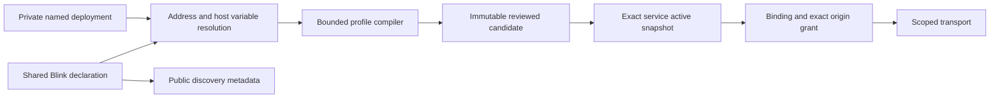

# Architecture Spine: multiple deployment addresses

## Design Paradigm

The existing bounded OpenAPI compiler consumes a shared declaration and local configuration and produces an immutable concrete execution snapshot. Runtime authorization depends on that approved snapshot. Discovery consumes public declarations and local approved inventory separately.



## Invariants and Rules

### AD-1: explicit address slots

- **Binds:** execution schema, address resolver, profile compiler.
- **Prevents:** developers treating arbitrary URL text or a missing hostname as a wildcard destination.
- **Rule:** `x-blink-service.addresses` declarations and whole-field `blink-address:<slot>` references follow the closed shapes and destination-field allowlist in the binding plan. Fixed declarations require a URL, forbid config keys and never consult private maps. Dynamic declarations require explicit private resolution and may expose an informational original URL. Unspecified declarations require private resolution and forbid a public URL. Unknown references and malformed URLs fail before staging.

### AD-2: private named deployment ownership

- **Binds:** private schema/API, CLI, MCP, source staging.
- **Prevents:** private FQDN publication, inconsistent local config keys and implicit production selection.
- **Rule:** only the private Blink owns `deployments[name].addresses[config]`. The explicit staging `deployment` input selects exactly one set. No implicit choice or dynamic URL fallback is permitted. A private bare FQDN, optionally with a port, normalizes to HTTPS; DNS/IDNA and IP literals are strictly checked and wildcards are forbidden. Only referenced slots require local resolution; all declarations are validated. Local extra keys are ignored unless referenced through a dynamic/unspecified config key. Values resolve before staging, remain private, and do not modify shared bytes or public catalog metadata.

### AD-3: immutable concrete execution snapshots

- **Binds:** compiler digest, candidates, approval, grants, transport.
- **Prevents:** private configuration edits redirecting previously approved credentials or authority.
- **Rule:** candidate compilation snapshots effective concrete address URLs, selected deployment and operation paths; these participate in its semantic digest. Editing private config cannot affect a staged or active snapshot. A new selection or address requires restaging and existing exact candidate approval; digest changes invalidate existing grants through the current approval transaction. Inspection-only unresolved compilations can never be installed or dispatched.

### AD-4: existing service namespaces isolate concurrent environments

- **Binds:** source manager, runtime bindings/grants, onboarding examples.
- **Prevents:** a new service identifier grammar bypassing source provenance or a binding silently changing environment.
- **Rule:** a canonical service remains `source:integration` with one active snapshot. Concurrent deployments use separately registered existing source aliases of the same package, each explicitly staged with its deployment. Existing service/account/grant checks enforce separation. Replacing a deployment within one service follows normal manifest replacement and grant invalidation. No automatic source creation or alias provenance rewriting occurs.

### AD-5: base URL paths remain execution semantics

- **Binds:** resolver, compiler, identity/refresh operations, transport.
- **Prevents:** private WordPress subdirectory installs routing calls or probes to the domain root.
- **Rule:** only address-resolved server base URLs can contribute a validated deployment prefix to their operation paths. Origins remain exact origin values without paths. Reject unsafe/ambiguous prefixes and post-expansion operation collisions. Ordinary manifests retain their old server-origin constraints. Account probes, refreshes and user calls use the same immutable expanded contract.

### AD-6: discovery remains advisory and public metadata stays public

- **Binds:** source package inspection, discovery catalog generation, installed inventory.
- **Prevents:** unresolved placeholders being published as real hosts or dynamic packages matching every URL.
- **Rule:** validate all declarations in metadata mode without requiring private config. Derive public host hints only from publisher-declared fixed/original URLs and ordinary public origins; never private values or compiler stand-ins. Match effective private addresses only in already local installed inventory. A dynamic-only package is findable by title/operation, without a universal host match.

### AD-7: learning preserves the approved deployment

- **Binds:** delta learning, anonymous read checks, full-document overlays and runtime staging.
- **Prevents:** learning reloading edited private endpoints, exposing private FQDNs in shared output or doubling WordPress path prefixes.
- **Rule:** an exact-parent overlay with no explicit deployment inherits the checked parent's frozen address values and deployment name. Explicit native selection creates a fresh reviewed resolution. Delta learning maps captured exact origin/path back to a unique parent slot using longest matching prefix, strips that prefix, and writes the logical server reference. Ambiguous or missing mappings fail before staging with actionable guidance. Anonymous checks and staging use the same frozen values. New referenced keys require explicit deployment selection.

## Consistency Conventions

| Concern | Convention |
| --- | --- |
| Shared data | Closed JSON Schema shapes, bounded slot/config identifiers and entry counts; additive execution/private schema editions in major 1. |
| Errors | Existing BlinkError/envelope conventions; absent private resolution is actionable and fails before candidate creation. |
| Compatibility | Old manifests preserve digests, compilation and exact origin policy; no package dependency is added. |
| Release | New Web Blink version, mirrored assets, ZIP/wheel checks and marketplace synchronization follow AGENTS.md. |

## Structural Seed

```text
schemas/execution-v1/openapi.schema.json   shared declarations
schemas/v1/private-blink.schema.json      local deployment sets
src/blink/addresses.py                    bounded reference/base URL resolver
src/blink/profile.py                      concrete compilation and digest
src/blink/private.py                      protected local persistence
src/blink/runtime.py                      immutable candidate and approval
src/blink/sources.py                      provenance-preserving source staging
src/blink/discovery.py                    public hints and local readiness
```

## Capability to Architecture Map

| Capability | Lives in | Governed by |
| --- | --- | --- |
| Multiple FQDNs and named test environments | Address resolver and private deployment sets | AD-1, AD-2, AD-4 |
| Original domain and private custom installation | Shared declaration plus explicit local selection | AD-1, AD-2 |
| Private WordPress under a subdirectory | Concrete operation compilation | AD-3, AD-5 |
| Existing exact credential/approval authority | Runtime candidate, binding and grant | AD-3, AD-4 |
| Discoverable reusable schemas | Public metadata and local inventory | AD-6 |

## Deferred

Per-binding environment variants within one canonical service are deferred: existing independent source aliases already supply concurrent isolation without changing service-ID grammar or authority ownership. Automatic private-install discovery and credential-specific environment overrides remain outside this URL resolution feature. Live private WordPress verification depends on an owner-provided installation; deterministic local fixture checks cover routing and isolation.
